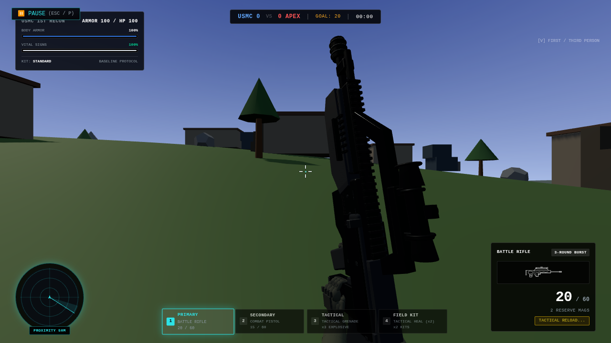
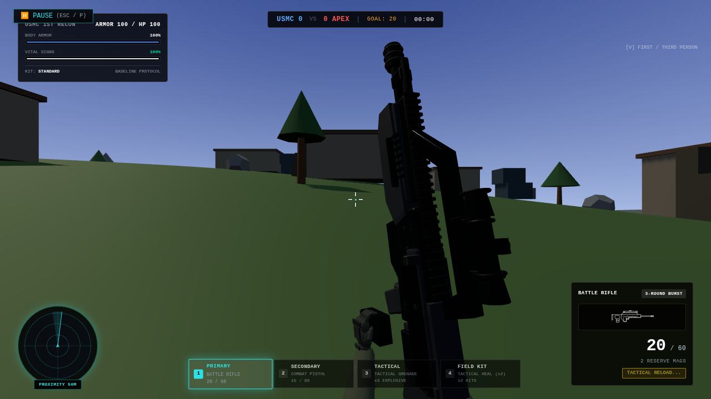
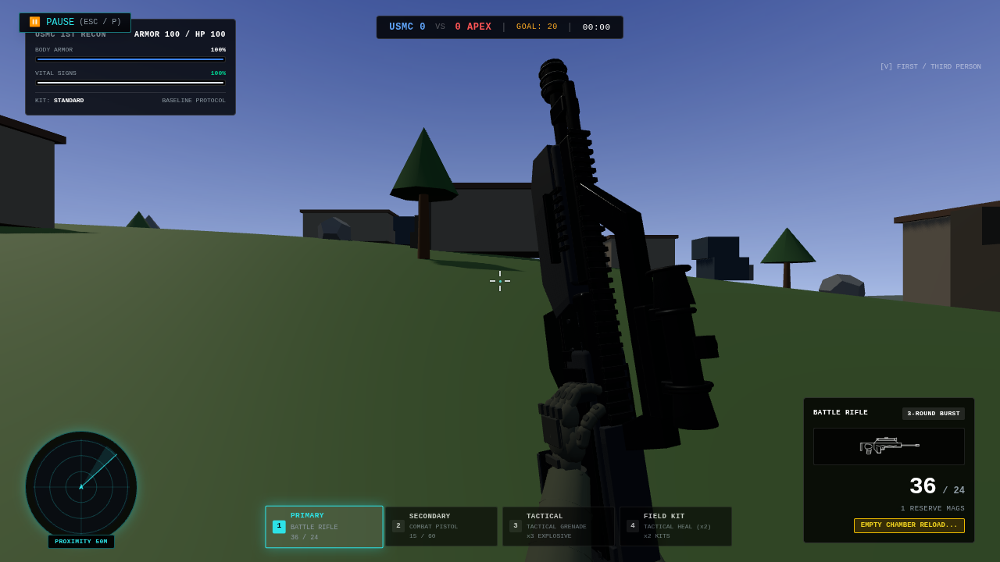
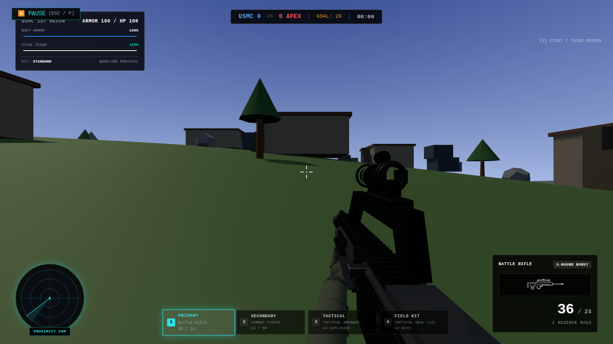

# Battle rifle fidelity

Started directly from `origin/main` at `7377e7a3279403ca88a679bbe330fecf80977764`.
No uncommitted changes, stashes or concurrent open PRs were present. Sniper PR #18
and the accepted hands/shotgun work are already in this main. Branch:
`feat/battle-rifle-fidelity`. Runtime: `b44998928b5c266c51b05e795e39e55c717b1a9f`.
The draft PR records the final evidence head and matching Preview URL. It targets main.

The BR has a dedicated upright animation: authored pitch 80.2°, measured muzzle
elevation **78.7°** in the rendered camera, rather than a sideways roll. The rifle
lifts, the support hand extracts the rear magazine, stows it below the viewport,
collects a visible matching replacement and seats it firmly before lowering.
Empty reloads also operate the near-side receiver control. The hand returns to
the front support grip while the weapon lowers, keeping capped sleeve ends outside
the frame and retaining the shared .25 m forearm bound.

The model adds a connected receiver spine, rear housing/cheek plates, open magwell
lips and joining webs, stronger firing grip, front chassis/support pad, butt shell,
fasteners and a carry-bridge-mounted optic. Magazine origin is now local `z=+.21 m`,
wholly behind the pistol grip. Extraction/insertion follows local −Y/+Y, not the
trigger area. The replacement is a cached clone of the real baked magazine,
sharing its buffers/materials; it is present only in the FP assembly. Default
actor/inspection models retain a static full stock and no spare magazine.

The firing hand stays anchored. The support wrist/fingers/thumb follow the actual
moving magazine in weapon-local coordinates; empty charging follows the actual
45 mm receiver control. No extra hand rig, per-frame mesh/material construction,
React animation updates or accumulated transforms. Existing owned-resource
cleanup releases shared references once. No changes to damage, 36-round capacity,
reserve rules, 75 ms three-round burst spacing, aim zero or hit detection.

| Standard class | Tactical | Empty |
| --- | --- | --- |
| Lift / reach | .40 s | .40 s |
| Extract | .45 s | .45 s |
| Stow / acquire | .30 s | .30 s |
| Insert / positive seating | .65 s | .65 s |
| Receiver charge | — | .60 s |
| Lower / support recovery | .45 s | .45 s |
| **Total** | **2.25 s** | **2.85 s** |

Previously .7488 / 1.32 s. Existing class speed multipliers scale the new profile.
Ammo/reserve transfer occurs once at **1.80 s**, at seating. Empty chamber clears
at **2.40 s**; firing remains blocked until reload completion. An interrupted empty
reload after seating resumes chamber-only (1.15 s), without another magazine grant.
Bot reloads retain their existing 1.32 s baseline. The legacy definition's 1.2 s
base remains for that path. Reload starts clear queued burst rounds; sprint still
blocks all player guns and cancels queued burst continuation.

## Audio

The short existing BR composites were inspected via their source-cut manifests
and PCM headers. Three isolated mechanics are cropped from the owned BR empty
recording, without synthesis, gain or tempo edits: removal 0–.249 s, insertion
.293–.843 s, charge .858–1.107 s. Original WAVs remain untouched. Exact source
samples are in `src/assets/audio/weapons/br-fidelity/clip_manifest.json`.
Authoritative callbacks start removal at .48 s, insertion at 1.23 s and empty-only
charging at 1.932 s. Normal playback speed at standard class; class modifiers
scale rate with pitch preservation. Late frames seek/skip stale cues, with one cue
per actual phase. Old composites are not layered. Pause/cancellation use the
existing audio lifecycle. No missing source is proven; a native listening test
is still needed to judge the weight/blend of these existing BR mechanics.

## Focused actual renders

Same actual Training camera/HUD, six full-resolution state-clock phase samples.
The separate functional smoke uses real keyboard/mouse input for complete reloads.

| Normal | Near vertical | Rear magazine removed |
| --- | --- | --- |
|  |  |  |

| Replacement entering rear well | Empty receiver action | Returned ready |
| --- | --- | --- |
|  |  |  |

## Checks and limits

Passed TypeScript/build, BR, weapons, viewmodel, tactical/reload, audio, sniper,
shotgun, controls and runtime suites. BR tests cover 30/60/144 Hz and class speeds,
finite reserves, exact transfer/cue boundaries, interruption and chamber-only
recovery, actual upright muzzle elevation, exact mag/control hand attachment,
anchored firing hand, repeated restoration and exactly-once resource disposal.
The production build retains its existing large-bundle advisory and no probe.

The bounded App smoke passed complete tactical (36/41) and empty (36/14) reloads,
bursts before/after reload, reload fire blocking, pause/resume, switch cancellation,
repeated equips with one spare, screen-left sprint/fire blocking, reload-to-held-
sprint, scoped ADS recovery, death and redeployment. Zero page errors. Six final
pose captures verify the consolidated moving lever; the bot cadence guard and
that geometry correction do not change the tested player input/state paths.
[Compact state transitions, audio events, test list and exact runtime file list](validation.json).

No full lighting/preparation/map benchmarks or long recording. SwiftShader frames
cannot establish native laptop pacing, sound quality or subjective hand comfort.
Visual/audio acceptance is pending; no merge, production promotion or later weapon
batch is performed. Reproduce with `npm run test:br`, `npm run test:audio`, and
`npm run test:br:browser` (bounded five-minute fixture; `BR_POSES_ONLY=1` for stills).
