# Battle Rifle structural rebuild

Baseline: `a912576e82e1fc3557bc49562f51d305129c5dce`. PR #19 remains a draft targeting main.

## Proportion plan (metres, before implementation)

Local +Y is up, +Z rearward, X across the rifle; muzzle points -Z. No global scaling.

| Feature | Before | Planned |
|---|---|---|
| Muzzle attachment | Z -.605, Y .015 | unchanged |
| Exposed barrel assembly | Z -.608 to -.220 | shorter exposed section, same attachment |
| Front handguard | Z -.432 to -.108, layered | Z -.460 to -.130, tapered volume |
| Upper receiver | Z -.147 to +.177, overlapping rear plates | Z -.130 to +.270, continuous chassis |
| Firing grip / trigger | grip pivot Z +.090 / trigger +.023 | unchanged |
| Rear magazine socket | [0, -.065, +.210] | unchanged; vertical extraction clear |
| Stock pivot | [0, 0, +.250] | unchanged |
| Buttpad rear face | Z +.364 | Z +.514 |
| Overall length | approximately .972 | approximately 1.122 |
| Grip-to-buttpad length | .274 | .424 (+55%) |
| Grip-to-muzzle length | .695 | unchanged |
| Receiver / rear shoulder length | approximately .320 / .128 | .400 / .264 |
| Carry bridge span | Z -.322 to +.132 (.454) | Z -.300 to +.140 (.440), thinner frame |
| Stock height | approximately .140 | .123–.140, tapered shoulder and cheek |
| Receiver width | .068 core, layered to .096 | .072–.084 actual chamfered hull |
| Optic group / sight axis | [0, .070, 0] / root Y .215 | unchanged |
| Magazine withdrawal corridor | X ±.0255, Z .165–.255, Y -.395–-.063 | protected |

The primary receiver and fore-end use connected longitudinal cross-sections rather than additional side-profile plates. The stock extends the structural housing behind the protected magazine socket. Its geometry remains owned by the existing stock anchor so first-person visibility and accepted reload restoration retain their existing contract. Restrained surface joints follow the new volume rather than concealing it.

## Implemented dimensions

Measured from actual baked actor/inspection geometry, not screenshot pixels:

| Dimension | Old | Rebuilt |
|---|---:|---:|
| Overall mesh length | .9715 m | 1.1207 m |
| Buttpad rear Z | +.3640 m | +.5140 m |
| Firing grip to butt | .2740 m | .4240 m |
| Grip to muzzle attachment | .6950 m | .6950 m |
| Stock-owned geometry length | .1380 m | .2440 m |
| Maximum stock width | .0720 m | .0840 m |
| Stock height incl. cheek / pad | .1336 m | .1420 m |
| Carry bridge span incl. bevel | .4540 m | .4440 m |
| Bridge top thickness | .0405 m | .0205 m |

The extra rear length is the load-bearing shoulder shell, not a thicker buttpad. Its octagonal sections vary in width, cheek height, underside height and chamfer. The central receiver and fore-end meet at identical cross-sections. The rear action continues into a supported, open-bottom magazine socket and then the stock. All redundant BR fairings, side plates, receiver overlays, generic handguard box/rail and ring-stack muzzle were removed. The short exposed barrel and machined brake preserve the original muzzle position.

The stock and receiver have shallow channels formed in their actual cross-sections. Eight fore-end cooling recesses have inset surfaces and physical rims. They are not additional black surface plates. All static surfaces still bake by existing material within each moving part; the assembly retains its owned materials and disposal conventions.

## Silhouette comparison and supplied reference

The reference is the user's side-profile image in this conversation; no commercial asset was imported. Compare these actual renders with that image:

| Supplied reference design cue | Old model | Rebuilt model |
|---|---|---|
| Long rear shoulder housing behind magazine | Short shell terminates close behind socket | 15 cm extension; cheek and shoulder taper continue behind socket |
| Continuous upper/lower chassis | Overlaid polygon plates and generic rifle boxes | Actual longitudinal hulls with matching adjoining sections |
| Shallow integrated fore-end | Large dark fairing over box | Tapered palm housing, slim nose, physical cooling recesses |
| Slim structural carry bridge | Thick frame | Half-thickness top, narrower width, supported scope saddle |
| Bullpup identity | Rear magazine among disconnected plates | Distinct rear magazine beneath supported open socket |

Matched side captures use the same 1280×720 viewport, camera, scale, weapon transform and existing armory lighting. Framing was widened for both models to include the longer butt. Materials, armory lights and background remain unmodified production settings. The silhouette and clay diagnostic views override materials only in the test fixture. The initial plain silhouette/clay were inspected before cutting the small recess details.

| Before | After |
|---|---|
| 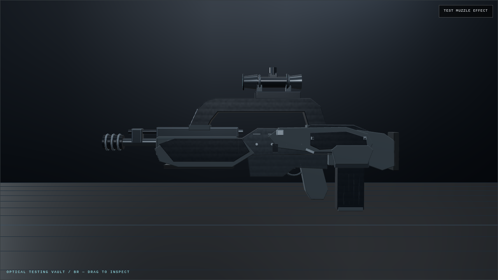 | 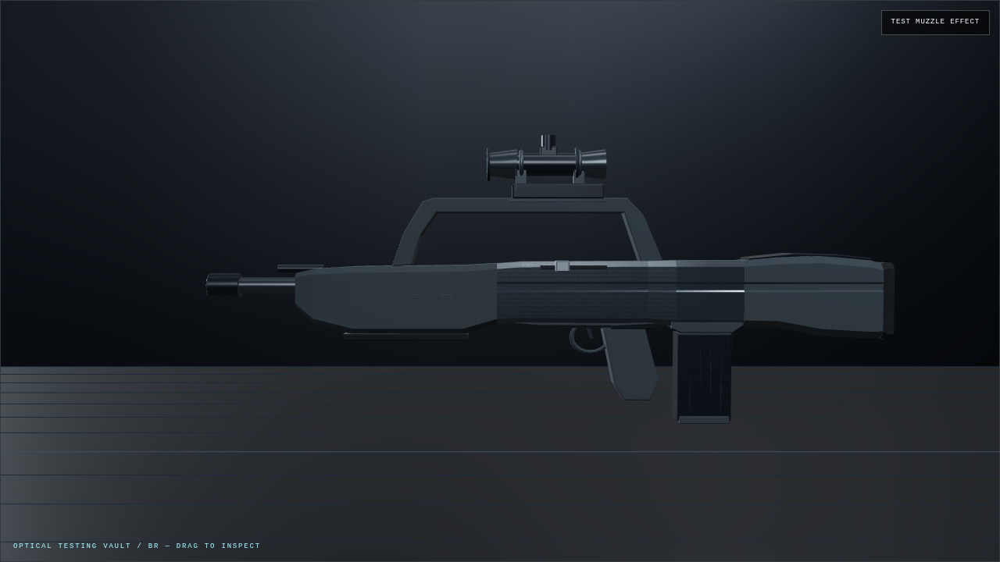 |
| 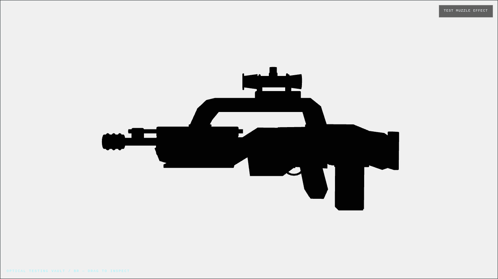 | 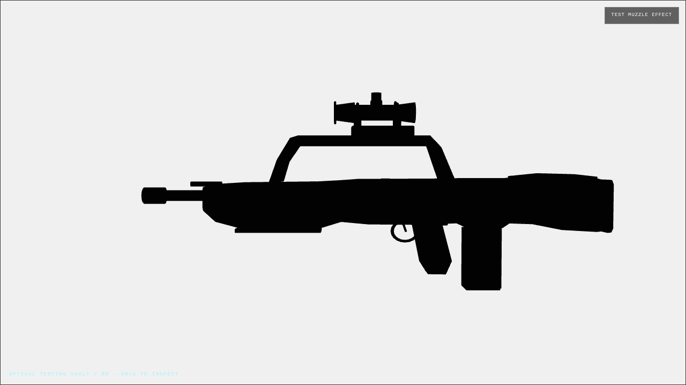 |

## Multi-angle geometry and actual gameplay

| Front three-quarter | Rear three-quarter |
|---|---|
| 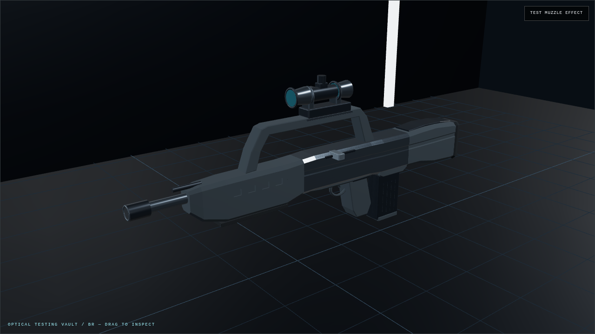 | 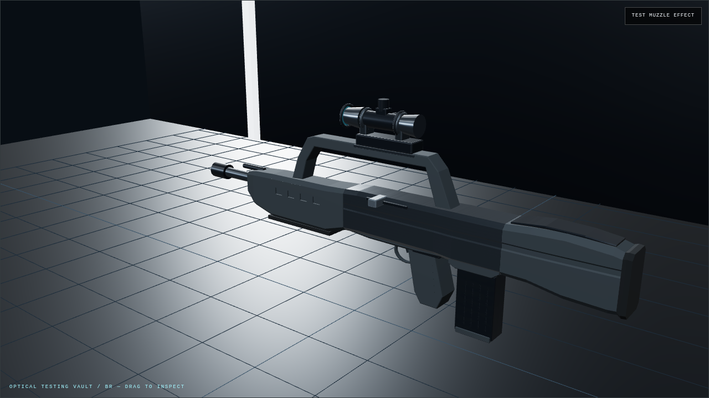 |

| Top/rear continuity | Neutral material geometry |
|---|---|
| 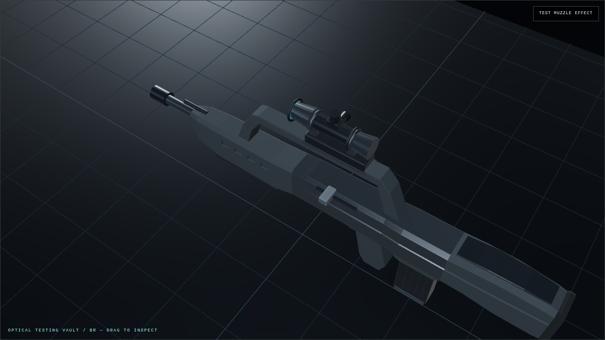 | 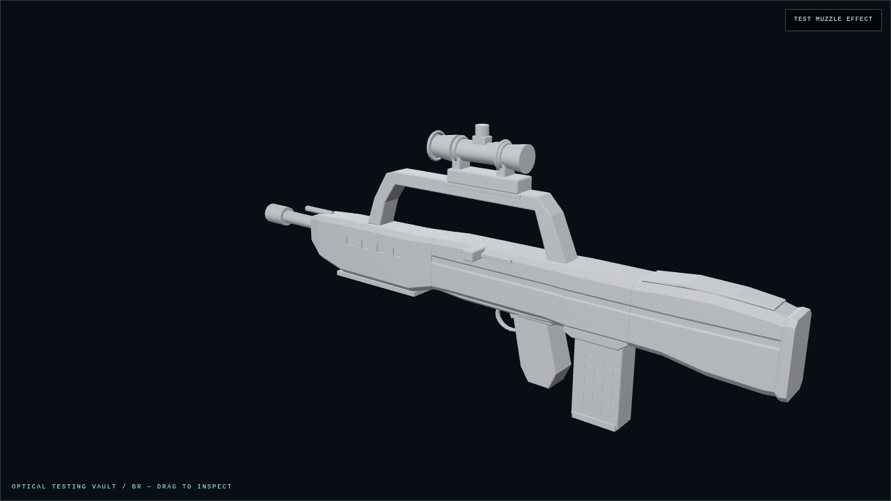 |

| Normal first-person hold | ADS |
|---|---|
| 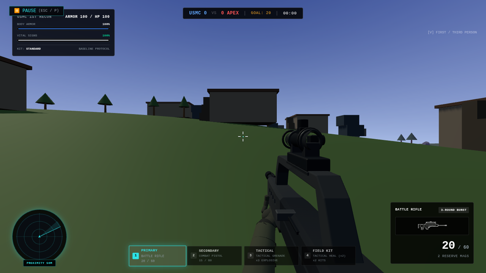 | 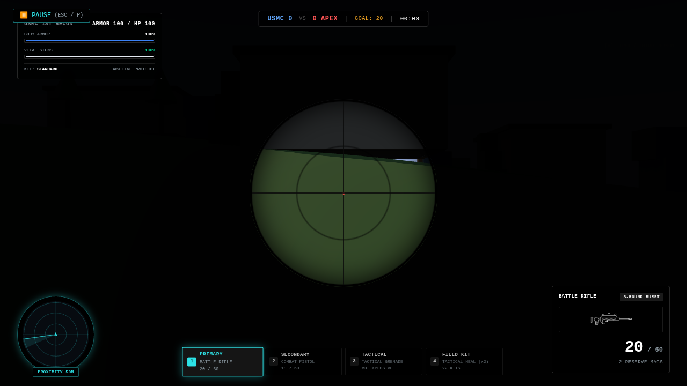 |

| Upright tactical reload at 1.72 s | Actual magazine withdrawn at .82 s |
|---|---|
|  | 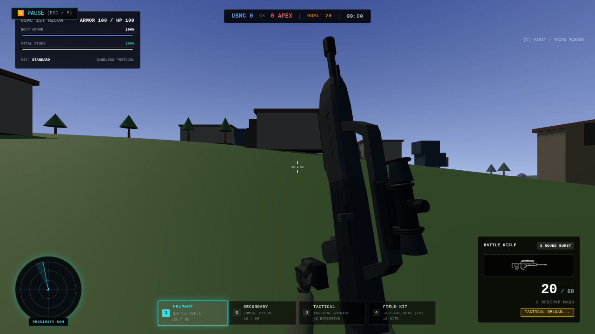 |

The game screenshots use the actual App/renderer and authoritative reload clock, with the fixture holding the specified time for capture. The separate input smoke exercises continuous gameplay. Production has no probe globals. Stock visibility follows the accepted first-person rule: hidden when shouldered, visible in the upright reload; full geometry is visible for actors and armory inspection. Hand geometry, attachment poses and idle/ADS transforms are unchanged.

## Validation

Passed:

- `npm run lint` and `npm run build`.
- `npm run test:br`, `npm run test:weapons`, `npm run test:viewmodel`.
- `node --import tsx tests/brVisualModel.test.ts`: protected anchors, every fixed triangle against the complete swept magazine corridor, meaningful stock extension, compact shoulder height, real transverse tapers and finite normals.
- Focused browser: `BR_GEOMETRY_REBUILD=1 BR_OUTPUT=performance-results/br-rebuild-after node scripts/test-br-visual-polish-browser.mjs`.
- Browser input checks: three-round bursts; tactical and empty reloads; correct 36/41 and 36/14 ammo transfers; one empty-only charging cue; pause/resume; switch interruption; repeated equip restoration; one cached spare magazine; screen-left sprint blocks firing; clean return to scoped ADS; death/redeployment. Zero page errors.
- Exact before/current hash comparison of all other 11 weapons: FP/actor geometry and materials, sampled hip/ADS/sprint/reload transforms, articulated hand data and reload state match.
- `battleRifleMechanics.ts`, `weapons.ts`, `weaponReload.ts`, audio sources/assets, grips, hands, App and game loop are byte-identical to the reviewed checkpoint. Muzzle, stock, optic, bolt and magazine anchors are unchanged. The model test verifies full withdrawal clearance. Existing viewmodel tests cover every visible vertex through full reloads and validate compact sleeves, framing, disposal and no per-frame model allocations.

Accepted handling remains unchanged: approximately 78.7° muzzle elevation, 2.25 s tactical reload, 2.85 s empty reload, original rear-magazine extraction/seating and empty-only charging, original three-round burst/cadence and audio. No gameplay or other weapon changes.

| Measured rendering statistic | Before | After |
|---|---:|---:|
| Bare actor/armory model draw calls | 15 | 15 |
| Bare model triangles | 12,360 | 6,356 |
| Actual armory scene draw calls | 21 | 21 |
| Actual armory scene triangles | 12,408 | 6,404 |

These are renderer counts in the fixed armory views, not an FPS benchmark. Chromium uses SwiftShader software rendering: the captures establish actual geometry/framing and the input smoke establishes behavior, but native GPU pacing, tactile feel and aesthetic acceptance require user playtesting. No broad APEX/map benchmarks or videos were generated. Preview protection remains enabled.

Full measurements, protected-source hashes, other-weapon hashes, browser outcomes and pose samples are in [validation.json](validation.json). PR #19 stays draft, targeting main, for user visual approval. No merge or production promotion.
