# BR visual design polish

Continues draft PR #19 on `feat/battle-rifle-fidelity`, base `main`.
Reviewed head: `eba00404bc86562a95d2e68740ed9a3dbbb11a15`.
Runtime: `05da46ccdfdf1a344b29a23ee214ec43f144b98f`.
The PR description records the final evidence head and exact Preview URL.

Only `src/weaponModels.ts` changes production behavior, limited to BR geometry
and owned materials. The four supplied views guide the compact carry structure,
connected bullpup body, underhand fore-end and graphite/composite finish; all
geometry remains original procedural Gun-Arena construction.

- A wider, lower carry arch has receiver attachment feet and a saddle under the
  existing optic mount. The opening is shallower; the duplicate toothed/side rails
  are removed. The scope's original axis is unchanged. Adjustment collars connect
  the previously floating turrets; the knobs now have physically appropriate axes.
- A faceted receiver spine, segmented action plates and tapered butt shell replace
  the long rectangular rear blocks. The cheek ridge, seams and fasteners follow
  those surfaces. Exterior shoulders reinforce the protected rear magwell without
  filling its loading corridor.
- The front chassis tapers to the barrel, with inset side panels, restrained vents
  and a defined underside support pad. The firing grip has a shaped palm profile,
  receiver collar and surface channels; the trigger guard remains distinct.
- Graphite alloy, matte composite and controlled steel highlights reveal contours
  in existing lighting. No decorative emission or new shader/material family.

Magazine socket `[0,-.065,+.21]`, muzzle, optic group `[0,+.07,0]`, charging control,
stock group and all hand attachments stay fixed. All eleven controller/state/audio
source files listed in validation are byte-identical to the reviewed head.
**78.7° elevation, 2.25 s tactical / 2.85 s empty, rear-mag exchange, seating,
charging, ammo, audio, burst, interruption and sprint lockout remain unchanged.**

## Matched before/after actual renders

Armory views use the actual WeaponStudio, its lighting and rotation model. Gameplay
views use the actual Training camera/HUD and accepted state-clock poses. Same
inspection cameras and matched viewmodel/action state; procedural backgrounds may
vary. No painted model renders or generated reference imagery.

| View | Before | After |
| --- | --- | --- |
| Armory side | 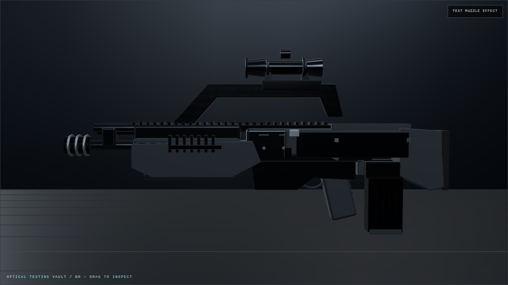 | 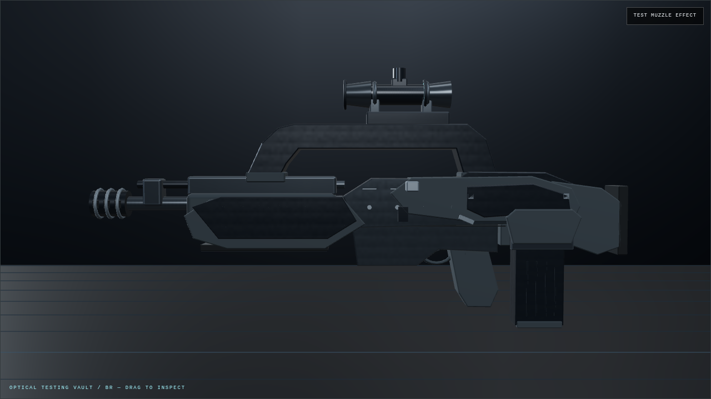 |
| Front three-quarter | 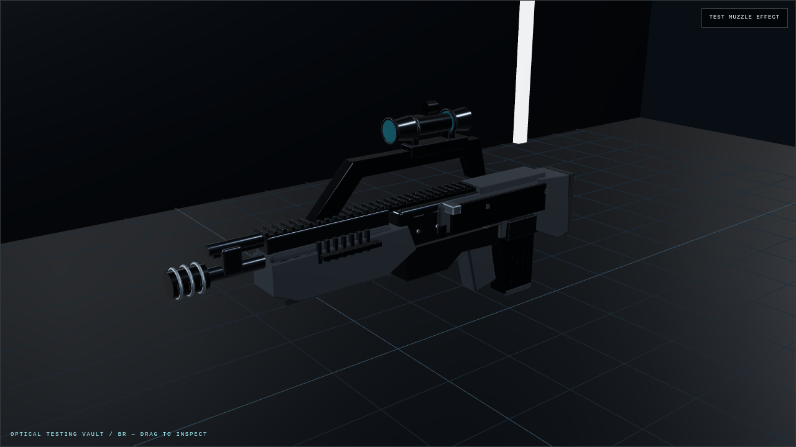 | 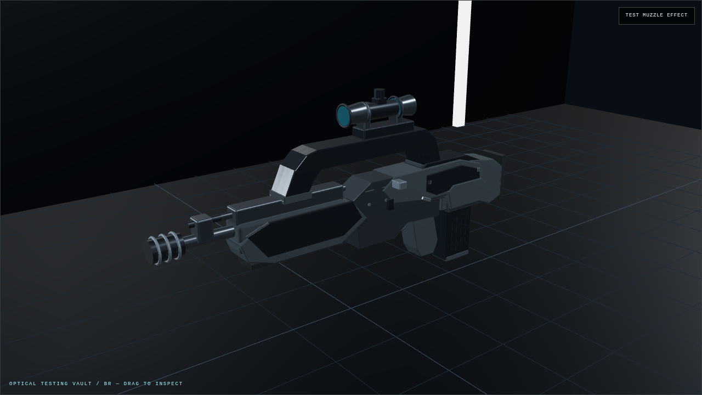 |
| Rear three-quarter | 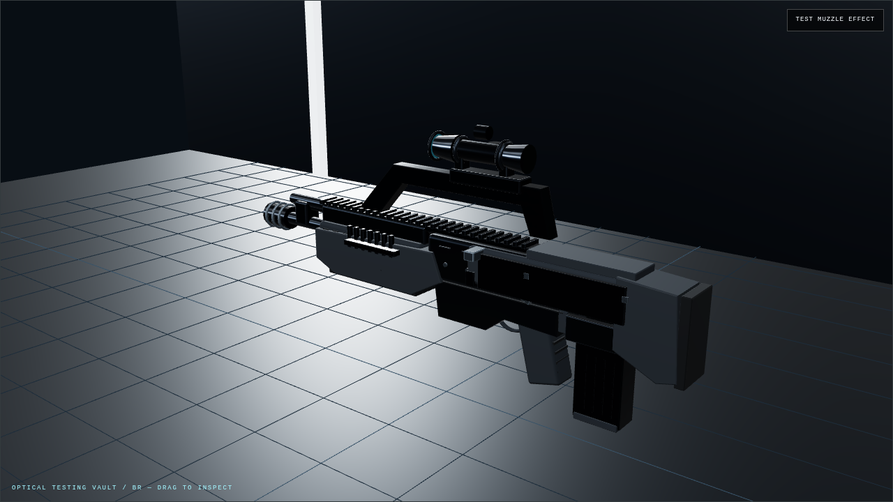 | 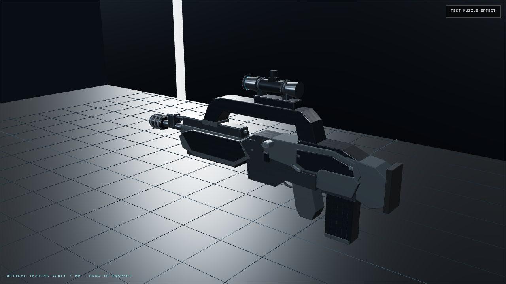 |
| First-person hip | 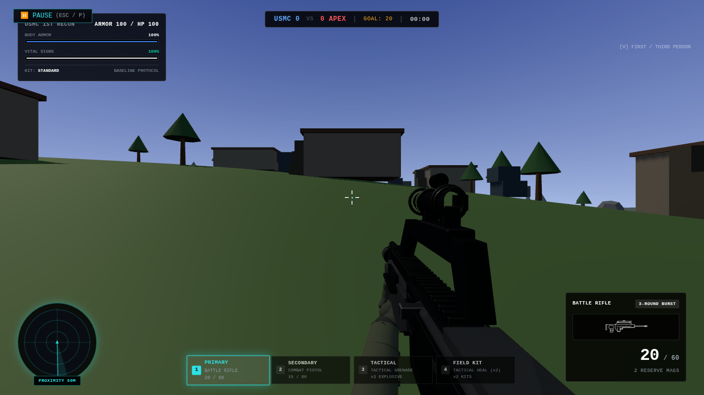 | 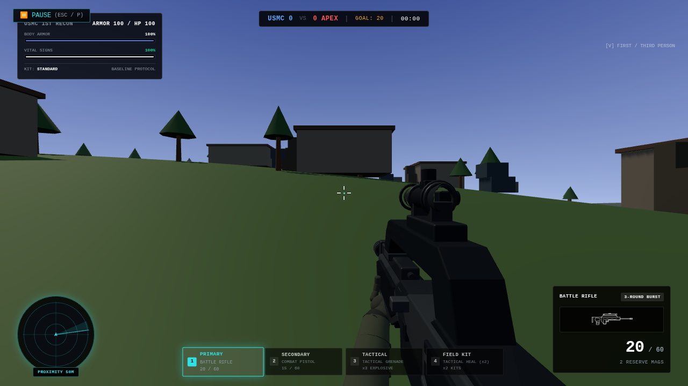 |
| First-person ADS |  | 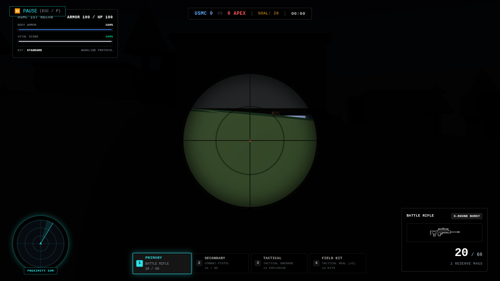 |
| Upright reload / rear well | 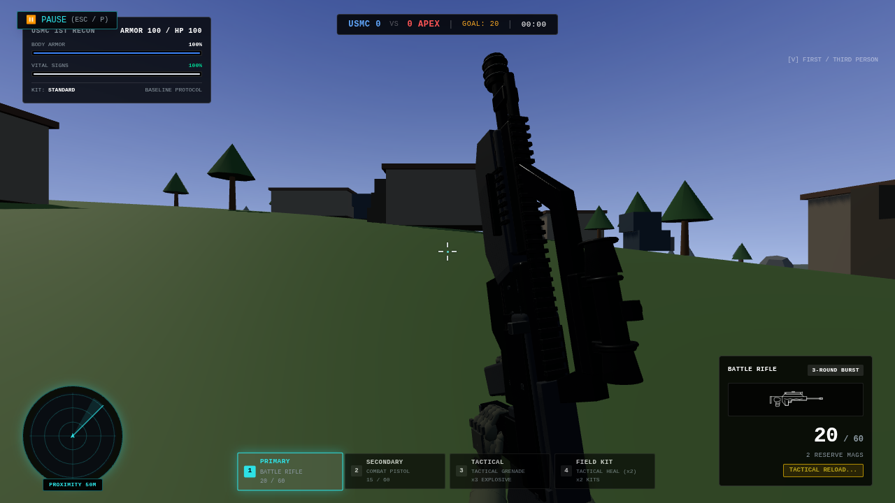 | 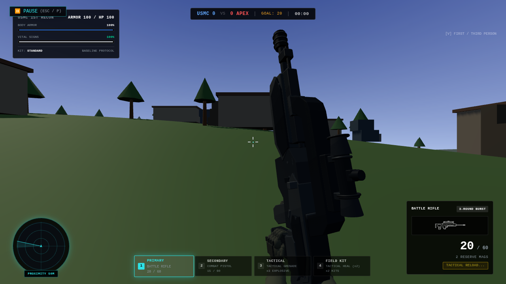 |

## Focused validation

Passed TypeScript, production build, weapon-model, viewmodel and BR tests. Added
FP/actor anchor assertions and fixed-triangle collision checks against the entire
magazine extraction volume. Existing exact hand/control contact, sleeve bounds,
near-plane, 30/60/144 Hz, class timing, ammo and exactly-once disposal checks pass.
Other eleven weapons retain identical FP/actor geometry/materials, hip/ADS/sprint/
reload poses, articulated palettes and gameplay reload state versus the reviewed
head. Production assets contain no probe. Existing bundle-size advisory remains.

The limited actual App check passed three-round bursts before/after complete
tactical reload, full empty reload with one charging cue, no doubled composites,
pause/resume, switch cancellation, repeated equips, left sprint and firing lockout,
reload-to-held-sprint, scoped ADS, death and redeployment. Zero page errors.
The same inspection scene retained **21 draws**, while rendered triangles changed
**17,032 → 12,408**. These are frame counts, not native GPU/FPS measurements.

[Structured results, unchanged-source hashes and exact 17-file manifest](validation.json).
Reproduce with existing `test:weapons`, `test:viewmodel`, `test:br`, plus
`node --import tsx tests/brVisualModel.test.ts` and
`node scripts/test-br-visual-polish-browser.mjs`.
`BR_MODEL_ROOT`, `BR_OUTPUT`, `BR_VISUAL_PORT`, `BR_POSES_ONLY=1` select baseline,
output and still-only capture using an archived reviewed head.

No long video or unrelated map/APEX benchmark. SwiftShader evidence establishes
shape/contact and functional continuity; native laptop comfort, finish and sound
remain for user acceptance. No animation compatibility adjustments were needed.
No known anchor or clearance defect remains; subjective design acceptance is pending.
PR #19 remains draft; no merge or production promotion.
