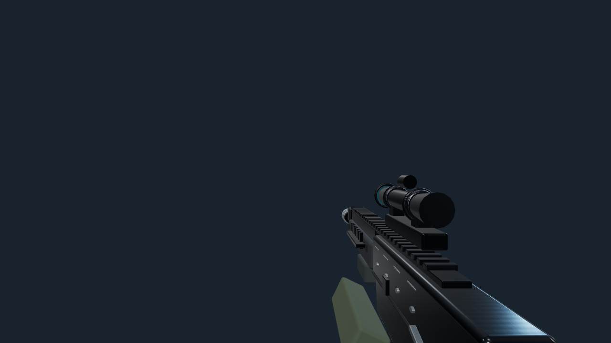
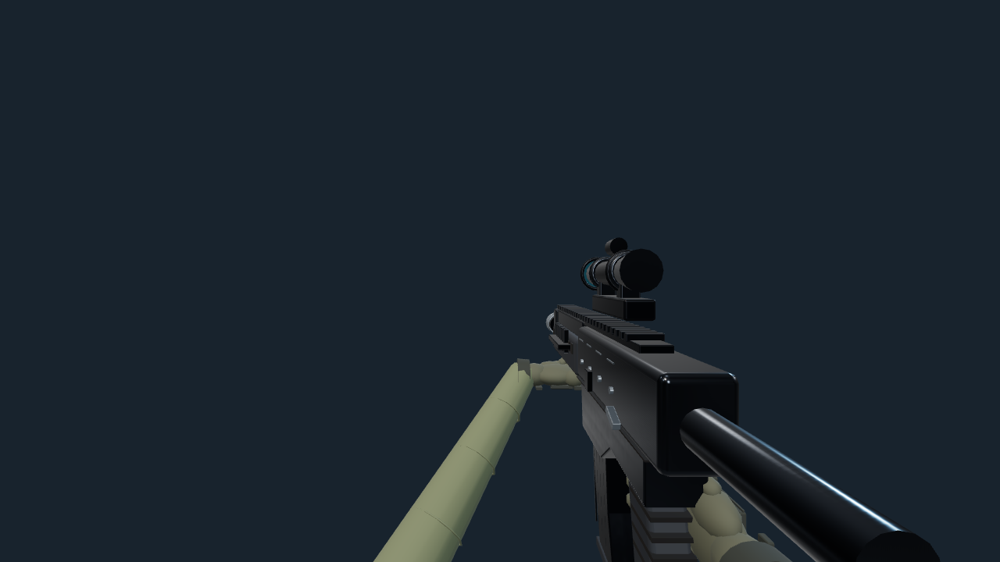
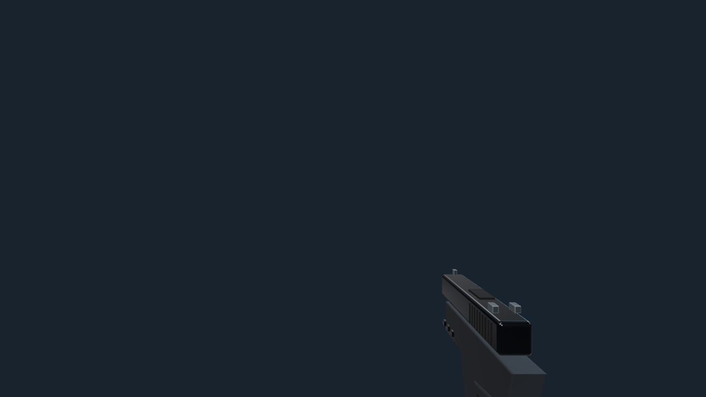

# Tactical Fidelity: first-person hands

Branch: `feat/procedural-first-person-hands-20261015`, based on main
`794fdfd` with merged controls PR #13 and combat preparation PR #14.

`createWeaponAssembly` is unchanged. `viewmodelGrips.ts` defines absolute
weapon-local metre-space attachments (+Y up, muzzle -Z), palm orientations,
finger curl, camera poses, body-anchored camera-space elbows and reload reaches
for all 12 weapons. The shotgun's support attachment follows its animated pump.
AR support is under its handguard; the pistol uses a two-hand grip; minigun hands
use its two rear spades; SMG/launchers use their vertical foregrips.

`viewmodelHands.ts` owns one reusable pair per viewmodel manager. Rounded palm
and wrist volumes, tapered sleeves, cuffs, seams and back panels use merged
geometry. Thirty articulated phalanges and knuckle pads use two instanced draws;
the full pair is eight meshes. Left-palm mirroring is baked into its owned buffer
with corrected winding, avoiding a negative-scale driver state. The rig is reparented to the selected cached
assembly instead of duplicated for each weapon. USMC/APEX palettes use owned
materials; faction is set once during deployment preparation.

The firing hand stays on its configured grip. The support hand independently
follows existing animated magazine/loading/control parts and recovers to its
attachment, without changing reload phases, ammunition or audio. Camera poses
and finger curls use exponential interpolation; cached rest transforms are restored before recoil,
bob, sprint and reload are applied. Pausing freezes animation and death/redeployment
resets presentation state. First-person stocks are hidden behind the eye to avoid
near-plane obstruction; inspection/character assemblies retain all their parts.

Existing `disposeBotVisuals(manager.root)` callers remain supported. A cleanup
hook releases instance buffers; shared buffers/materials/textures are still
released once by the existing traversal. An idempotent `manager.dispose()` is
also available. Animation allocates no geometry, materials or scene objects.
New lathed finger buffers exclude degenerate pole triangles so the existing
one-primitive lighting-preparation path draws a real triangle.

Focused viewmodel, weapon and tactical tests, TypeScript and production build
passed during implementation. `test:viewmodel` exercises all grips, orientations,
switching, frame-rate-independent ADS, independent reload poses, pause/death,
allocation invariants and both cleanup paths. Before screenshots were captured
from main at 1280x720 with the same fixture lighting.

The held fixture validates all 12 configurations, both palettes, AR/pistol hip,
ADS, reload and sprint poses, and 4:3/16:9/21:9 views. It checks hand vertices
against the near plane and raycasts the centre sight line. The actual App checks
both factions in Training (zero allies/one hostile via valid lobby controls):
preparation, fire, RMB ADS, reload, pause/resume, pistol switching, first/third
person, death, replay and lobby return. Replay retains exactly one hand pair;
the first-person sequence adds no shader programs after readiness.

The focused WebGL preparation fixture additionally constructs new hand rigs at
all 22 actual transient light counts and alternates both palettes. It passes
without new first-use programs, alongside existing resize, cancellation, renderer
restoration and pixel checks. Loading/preparation orchestration remains unchanged.

Measured at 1280x720/DPR 1 in Chromium 154/ANGLE SwiftShader with the same neutral
room lighting, comparing an archive of main `794fdfd` with this branch:

| Held fixture | Main calls / triangles | New calls / triangles |
| --- | ---: | ---: |
| AR | 19 / 16,492 | 26 / 24,544 |
| Pistol | 9 / 4,208 | 19 / 13,340 |

The totals include the weapon parts made visible by the corrected poses. The hand
pair itself has eight meshes, six owned/shared BufferGeometry objects and three materials;
two dynamic instance buffers total 3,840 bytes. Cached animation/switching creates
no geometry, materials or scene objects. CPU pose-update p95 was approximately
0.1 ms before and after, at the browser's coarse timer resolution. This is not a
native GPU/FPS benchmark or proof of zero frame-time overhead.

Browser output is under ignored `performance-results/viewmodel*`; selected final
comparisons and a compact validation record accompany this document. Native laptop
frame times, long-session stability and subjective animation acceptance remain
outstanding. Reloads reuse the existing phases/control transforms; complete
weapon-specific choreography and the other roadmap batches are outside this change.

Before/after captures use the same camera and lighting. The original hands sit
mostly below the first-person viewport; the new profiles bring the grip into view.

| Weapon | Main | Updated |
| --- | --- | --- |
| AR |  |  |
| Pistol |  |  |

Additional review: [grip detail](viewmodel-images/grip-detail.png),
[AR ADS](viewmodel-images/ar-ads.png), [APEX pistol reload](viewmodel-images/apex-pistol-reload.png),
[minigun spade grips](viewmodel-images/minigun-after.png),
[actual USMC gameplay](viewmodel-images/game-usmc-ar.png) and
[actual APEX gameplay](viewmodel-images/game-apex-pistol.png).
Structured results: [first-person-hands-validation.json](first-person-hands-validation.json).

Complete changed-file list:

| File | Purpose |
| --- | --- |
| `src/viewmodelHands.ts` | Reusable hand mesh, articulation, reload reaches and ownership |
| `src/viewmodelGrips.ts` | All twelve grip/pose profiles and live pump attachment |
| `src/weapons.ts` | Shared rig integration and viewmodel pose/lifecycle controls |
| `src/App.tsx` | Apply the chosen faction during deployment preparation |
| `tests/viewmodel.test.ts` | Grip, animation, allocation and cleanup regressions |
| `scripts/test-viewmodel-browser.mjs` | Optional isolated held preview and actual-game checks |
| `scripts/test-preparation-browser.mjs` | Fresh hand rigs at all prepared light counts |
| `package.json` | Viewmodel test commands; dependencies/lockfile unchanged |
| `docs/first-person-hands.md` | Architecture, results, comparison gallery and acceptance |
| `docs/first-person-hands-validation.json` | Current-run machine-readable evidence |
| `docs/viewmodel-images/ar-before.png` | Original AR capture |
| `docs/viewmodel-images/ar-after.png` | Updated AR capture |
| `docs/viewmodel-images/pistol-before.png` | Original pistol capture |
| `docs/viewmodel-images/pistol-after.png` | Updated pistol capture |
| `docs/viewmodel-images/grip-detail.png` | Held grip close-up |
| `docs/viewmodel-images/ar-ads.png` | Centre sight clearance |
| `docs/viewmodel-images/apex-pistol-reload.png` | Independent reload support hand |
| `docs/viewmodel-images/minigun-after.png` | Specialty rear handle placement |
| `docs/viewmodel-images/game-usmc-ar.png` | Actual game, USMC |
| `docs/viewmodel-images/game-apex-pistol.png` | Actual game, APEX |

Manual laptop acceptance before merge:

1. Compare main/preview at identical graphics, FOV and display scale; record native
   GPU/browser and frame-time trace while walking, sprinting, ADS and firing.
2. For both factions, inspect AR/pistol grip silhouettes and empty/tactical reloads;
   pause mid-reload, resume, switch slots, toggle perspective, die and replay.
3. Check sniper/BR scoped visibility, minigun rear grips and shotgun pump contact;
   resize to 4:3 and ultrawide. Confirm the armory still shows bare weapons.
4. Run a normal match/Extraction and confirm loading, first-fire and sustained
   frame times remain acceptable on the target laptop.

```sh
npm run test:viewmodel
BENCHMARK_BROWSER=/usr/bin/chromium BENCHMARK_SINGLE_PROCESS=1 DISABLE_HMR=true \
  npm run test:viewmodel:browser
```
