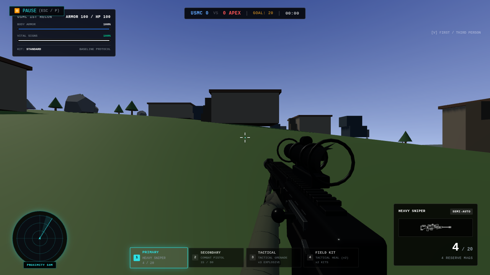
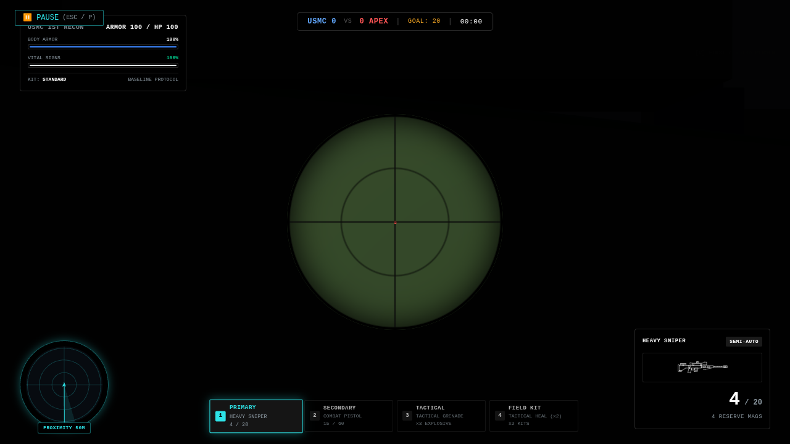
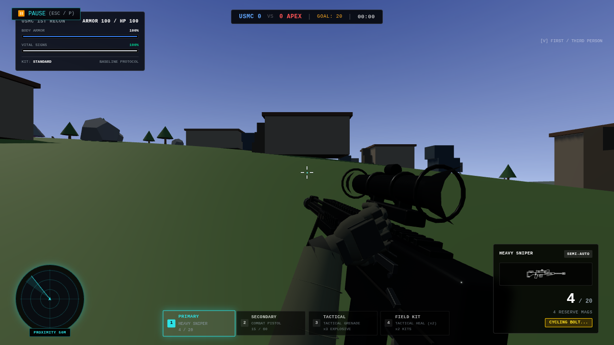
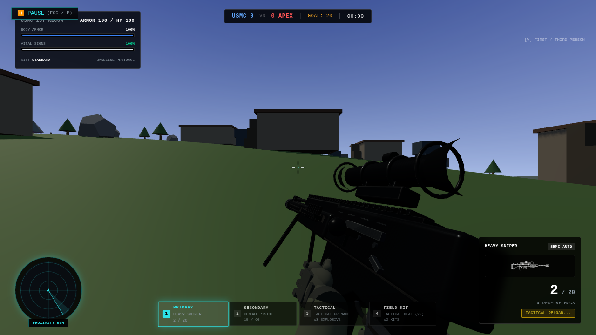
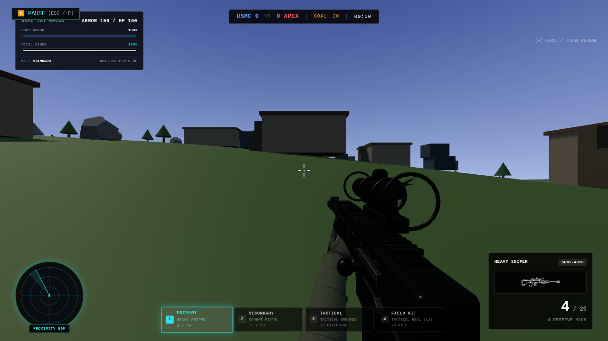

# Heavy sniper fidelity, Batch 2

Runtime: `77447dcb0d2561e8777cee06f8f1484187230635`. Final evidence head and
exact Vercel Preview are recorded in the draft PR. User laptop acceptance pending.

## Verified foundation

At inspection, main was `be2fc37bbf5cda996f324517dbf459ddac8fc0a0`.
PR #15 had merged into main. PR #17, including shotgun reload-height fix
`fe327c33706e71555ee272ac8e263e249a080187`, had subsequently merged into #15's
feature branch, producing `3e4e0688d707d1d35750f21ed09f37934683aeaf`.
Main therefore did not yet contain the shotgun work. No open concurrent PR,
uncommitted work or stash was found.

Branch `feat/heavy-sniper-fidelity-batch2` starts at that combined integration
head and targets `feat/procedural-first-person-hands-20261015`. Its diff contains
the sniper work and the requested universal sprint firing block. Neither previous
PR nor main was merged or changed by this task. Bring the accepted shotgun
integration into main through the owner's normal review process before unstacking.

## Controls and state

Previously a shot started an automatic .85 s bolt animation and bolt sound.
Now a shot consumes its existing round and leaves `needsChamber` true indefinitely.
Clicking or holding fire cannot operate the action. **Press R to cycle the bolt.**
The HUD and controls guide show the binding.

- With rounds remaining and a pending bolt, R operates the bolt only.
- When ready, R performs a tactical magazine exchange without cycling.
- Empty R exchanges the magazine, leaving the chamber unready. **Press R again**
  to cycle and chamber. Empty reload never silently operates the bolt.
- The existing five-round ammo representation and 1.45 s firing interval remain.
  Cycling never grants or consumes ammunition.
- Repeat R cannot restart an active cycle. Fire is blocked throughout it.
- Switching freezes bolt progress; returning continues it. An interrupted sound
  resumes from its current portion rather than restarting the recording.
- Pause freezes progress/audio. Death and match cleanup cancel actions; fresh
  deployment creates fresh state. Magazine exchange interruptions keep only
  rounds already committed by the existing transfer boundary.
- Holding RMB temporarily leaves the scope during manipulation and restores ADS
  afterward. Magnification, spread, raycasts and hit damage are unchanged.

| Manual cycle | Time (s) |
| --- | --- |
| Reach/contact | 0–.160 |
| Unlock | .160–.300 |
| Rearward slide | .300–.520 |
| Rear stop | .520–.580 |
| Forward | .580–.830 |
| Lock | .830–1.010 |
| Return hand | 1.010–1.170 |

Receiver slide is bounded to **55 mm**. The player-near knob has a local pivot
and contact anchor; the hand tracks that transform with the same clock. It stays
forward of the stock boundary and resets exactly. The shared glove rig and .25 m
sleeve bound are retained. The sniper rests 30 mm higher and 15 mm farther forward
than before, at camera-local `[.15,-.19,-.405]`; the existing scope alignment stays.

Magazine motion follows the real magwell vertically, with an initial reach,
accelerating removal/insertion and a small seating impulse. Both magazine swaps
are 1.8248 s at standard class speed; empty additionally needs the manual 1.17 s
action. Bot reloads explicitly retain their existing 2.97 s automatic behavior.

The sniper flash is a compact .075 s flare with shorter cone, lower light energy
and no expanding blue shock ring. Existing bounded effect buffers are reused.

## All guns: sprint firing block

`canPlayerFire()` guards the actual trigger/launcher dispatch, direct heavy firing,
burst continuation, railgun charging/release, minigun warmup/fire and plasma beam.
Entering sprint cancels queued burst rounds and sustained fire audio; railgun
charge cancels and the minigun winds down. Ammo, heat and damage cannot advance
from firing during sprint. Automatic weapons may resume when sprint ends and fire
remains held; semi-automatic weapons need another press. Grenade throwing and
consumable controls keep their existing behavior.

## Owned audio

All five sniper WAVs remain byte-for-byte unchanged. PCM headers and the adjacent
source-cut manifest were inspected. The .780 s single-shot clip excludes the bolt
source; only it plays for the player shot. The separate .850 s mechanical clip
starts at actual handle contact/unlock (.160 s after R), fitted to the .850 s
mechanical window. Late frames seek within the cue and never replay an obsolete
cue. The bot composite remains on its existing bot callback.

Both magazine exchanges reuse the 1.684792 s tactical recording after the .140 s
reach, fitted to class speed. The old empty composite includes chamber operations,
so the player no longer plays it. No new assets, downloads or missing replacement
request. Audio events are automated checks; sound quality still needs listening
on the user's laptop.

## Compact rendered evidence

Seven full-resolution phase samples in the actual Training scene/camera/HUD.
The fixture samples the authoritative state clock for these stills. The separate
functional run uses actual App keyboard/mouse events. No continuous video or
broad rendering benchmark was generated.

| Hip | Scoped ADS |
| --- | --- |
|  |  |

| Handle closed/contact | Open/rear stop | Returning |
| --- | --- | --- |
|  |  |  |

| Magazine insertion | Returned ready |
| --- | --- |
|  |  |

## Validation

Passed TypeScript, production build, sniper, weapons, tactical/reload, controls,
audio, shotgun, viewmodel and runtime suites. The build retains its existing
large-bundle advisory. New tests check 30/60/144 Hz, lockout/input spam, ammo
conservation and interruption, exact moving-control hand attachment, bounded
receiver travel, repeated transform restoration and unchanged bot reload timing.
Actual App trigger functions reject all twelve guns while sprinting.

The bounded browser run passed actual shot → blocked repeated/held clicks → R →
switch → pause → completion → second shot; tactical and empty reloads; manual
chambering; held-RMB ADS recovery with hidden hands/receiver; all twelve guns'
sprint holds, including precharged railgun/nearly-warm minigun/queued BR burst;
death and redeployment. Zero page errors. Production assets contain no probe.

Existing viewmodel/resource tests passed, including zero per-frame mesh/material/
geometry construction and exactly-once disposal. Preparation/shader code, physics,
AI decisions, damage and other weapons' animations are unchanged. No native GPU
performance measurement or broad APEX/lighting/map benchmark was run. Chromium
SwiftShader cannot establish normal laptop pacing or audible quality.

[Structured App samples, sprint checks and audio events](validation.json).
Reproduce: `npm run test:sniper`, `npm run test:audio`,
`npm run test:sniper:browser` (bounded five-minute timeout).

Stop for laptop visual/audio acceptance. No battle rifle or later batch is started.
