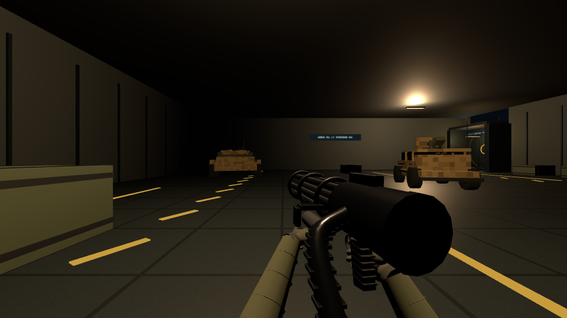

# W04 final first-person holding correction

Continues **PR #29**, `feat/w04-minigun-carry-fidelity`, from verified head **cdc17f0ff4eff9fd480a725139f1c074ef309576**. The developer accepted firing, rotation and thermal gameplay. This pass corrects the remaining visual support and overheated-hand motion using the supplied carrying image and 6.4-second gameplay recording.

## Result

The left palm genuinely contacts the existing fixed underslung cylinder, with the distal index finger curved around its far edge. The support wrist, finger/thumb bends and outboard elbow direction are calibrated together. The receiver moves forward/up/right with a modest yaw so its rear cap and ammunition chute no longer hide both wrists and the left forearm. The firing hand retains its accepted physical control-grip attachment. Both sleeves remain anatomically bounded at 30 cm, with their proximal ends outside the viewport.

The support hand no longer uses the generic receiver-loading reach. It relaxes its fingers, clears down/outboard, gives one restrained heat reaction, returns along the same clear path and wraps the **same physical cradle**. A smaller cooling presentation cant keeps the supported rear grip readable. Thermal timing, vent geometry and action ownership remain unchanged.

## Actual first-person footage

- [Continuous idle → walking → sustained firing → automatic overheat → regrip](first-person-hold-and-overheat.mp4), **11.4 seconds**, 960×540, 30 FPS.
- [Overheat and return detail](overheat-recovery.mp4).
- [Before/after and sequence contact sheet](contact-sheet.jpg).
- [Idle](idle.png), [walking](walking.png), [firing](sustained-fire.png), [withdrawal](hand-withdrawal.png), [heat reaction](heat-reaction.png), [return](return-approach.png), [regripped](regripped.png).
- [Area 51 idle](area51-idle.png) and [ADS](area51-ads.png), using its existing lighting.
- Matched previous branch-head [idle](before-idle.png) and [ADS](before-ads.png).

The video uses the **complete production App**, actual keyboard/mouse handlers, player movement, firing/damage, rotor, heat, cooling and Three.js renderer. A test-only clock advances the App at 120 Hz; four updates produce each exported 30 FPS frame. It is silent, **offline normal-speed simulation playback**, not an unretimed native-GPU performance recording. No substitute hands, lights, materials, weapons or map objects are added. The existing large yellow cooling plume is preserved and can cover the weapon's right side; the left withdrawal remains visible. The video uses Training Field for readable silhouette; Area 51 has additional actual rendered stills.

[Per-frame states, clip ranges and provenance](video-provenance.json) record the continuous sequence. The final code also has a separate native browser RAF/input smoke path in the capture helper; [live results](live-validation.json) report that separately. Routine software-WebGL rendering is suspended during that smoke test except at explicit screenshots. Neither form establishes laptop performance or audible acceptance.

## Exact tuning and timing

All coordinates below are weapon-local metres, +Y up and −Z forward, except camera-local elbow/carry targets. No weapon geometry is changed.

| Item | Final value |
|---|---|
| Left wrist | (−.133118, −.132860, −.125000) |
| Actual cradle-relative attachment | (−.053118, −.047860, +.015000) |
| Left wrist Euler XYZ | (1.6043094885, .0582213549, −2.0934999556) rad |
| Left finger bends | (.050, .209, 1.397) rad |
| Left thumb bends | (.474, .802, .904) rad |
| Hip carry / Euler XYZ | (.220, −.150, −.640) / (0, .200, −.035) |
| ADS carry | (.075, −.140, −.640), original zero ADS rotation |
| Left / right elbow target | (−.160, −.560, −.340) / (.400, −.580, −.270) |
| Right firing attachment | (.038, −.150, .075), unchanged |
| Sprint carry, inertia, recoil | Existing branch values retained |
| Maximum thermal withdrawal | 72 mm left, 72 mm down, 36 mm rearward |
| Heat reaction | One 4 mm dip, .065 rad roll, bounded withdrawal rotation |
| Cooling presentation cant | (−.025, .045, −.080) rad |

The hand derives progress by summing the **existing reload sequence's actual durations and elapsed phase time**. There is no new heat or action clock. At multiplier 1 the authoritative action is still **2.20 s**, and its existing `vent`/`close` phases are still .55/1.65 s. The existing independent emergency vent timer is still 2.00 s. Class scaling applies once through the original sequence.

| Choreography | Normalized progress | Baseline time |
|---|---|---|
| Relax fingers | 0–.13 | 0–.286 s |
| Clear below/outboard | .10–.30 | .220–.660 s |
| Restrained single heat reaction | .32–.56 | .704–1.232 s |
| Approach original cradle | .62–.91 | 1.364–2.002 s |
| Palm contacts, fingers wrap/settle | .91–1 | 2.002–2.200 s |

Smoothstep ramps have zero velocity at their ends. Position/orientation remain continuous across the existing phase boundary. The animator is stateless with preallocated quaternion/Euler scratch, so pause follows the existing clock and switching/reset introduces no independent timer. Manual and forced cooling use the same existing sequence.

## Verification

TypeScript, production build and **16 test commands pass**, including Minigun, viewmodel, weapons, audio, runtime, controls, scenes, tactical, Area 51, bosses, both batches, performance, Plasma tactile, Railgun and pistol sprint. [Results](checks/results.json) and individual transcripts in [checks](checks/) include the existing Vite large-bundle advisory.

The focused Minigun suite sweeps real palm, instanced phalange and forearm vertices through movement, ADS, sprint, firing and the **entire thermal action at 240 Hz**. The actual load-bearing palm and a distal finger both meet the cylinder within 1 mm; all sampled glove vertices remain outside it. Minimum sampled cradle clearance is .300 mm, motor 6.912 mm, rotating barrels 28.901 mm and chute 99.152 mm. Maximum support-hand change at 240 Hz is 1.534 mm / .002101 rad, including phase changes and completion. The right hand stays anchored throughout. No per-frame geometry/material/Object3D creation is introduced. Class factors .65/1/1.4 retain the same normalized contact path. Existing frame-rate-independent carry, pause/switch/reset and resource disposal checks pass.

The App capture verifies real .50-second warmup, full rotor spin, sustained fire into automatic overheat and complete recovery, with 999/999 supply unchanged. Actual ADS, sprint, pause, switch/re-equip and original warmup/fire/spin-down/cooling audio asset events are exercised without page/shader errors. Native RAF smoke results are reported separately above.

[Other-weapon comparison](preserved-other-weapons.json) proves identical geometry/materials, articulated hand buffers, hip/ADS/sprint transforms and full reload state for all eleven other weapons. [Preservation hashes](preserved-systems.json) prove **117 existing source/asset files byte-identical** to the inspected head. This includes the complete `App.tsx`, `weaponModels.ts`, `botBuilder.ts`, `world.ts`, `area51World.ts`, `gameLoop.ts`, `weaponReload.ts`, audio and WAV assets. The Minigun model is not remodeled. The Engineer deployable model and gameplay for Issue #28 remain untouched. Damage, ammunition, spin-up/down, cadence, heat, cooling, audio, movement and recoil are preserved.

## Reproduce and review

`npm run test:minigun`; `npm run test:viewmodel`; `MINIGUN_OUTPUT=work/minigun-hold node scripts/test-minigun-hold-browser.mjs`. Set `CHROMIUM_PATH` if needed. The helper uses a test-only Vite transform; none of its globals/clock hooks ship in the production build. `MINIGUN_POSE_ONLY=1` captures idle/ADS; `MINIGUN_MAP=area51` uses the facility; `MINIGUN_LIVE_ONLY=1` runs just the independent native-RAF smoke. `MINIGUN_ROOT` selects an isolated baseline checkout.

[Exact changed-file manifest](changed-files.txt). Leave PR #29 open and draft for developer first-person review. No automatic merge, production promotion, other roadmap work or Engineer repair. Native laptop visual/handling/sound acceptance remains with the developer.
