# W04 final first-person positioning correction

Compared with branch head `901d2ab11eda7f8d89bea633a9ab436d0b1ec769` on `feat/w04-minigun-carry-fidelity`, existing draft PR #29. This correction lowers the complete first-person Minigun assembly by **0.03 m**. The accepted top handle, control grip, hands, materials and model are retained.

## Implementation and position values

`src/weapons.ts` adds one Minigun-only translation after `hands.update()`. The manager rebuilds the root from its interpolated carry pose each update; the offset does not accumulate. Applying it after the camera-space arm solve moves the gun, gloves and sleeves together, preserving their relative transforms and existing clearances. There are no added per-frame allocations.

The authored values in `src/viewmodelGrips.ts` remain unchanged. Effective camera-relative resting targets, excluding existing bob/recoil/animation offsets:

| State | Previous XYZ (m) | Corrected XYZ (m) |
| --- | --- | --- |
| Hip | `[0.23, -0.19, -0.71]` | `[0.23, -0.22, -0.71]` |
| ADS | `[0.15, -0.18, -0.73]` | `[0.15, -0.21, -0.73]` |
| Sprint | `[-0.025, -0.29, -0.66]` | `[-0.025, -0.32, -0.66]` |

X/Z, scale, rotation, inertia, interpolation, camera and FOV are unchanged. The post-solve translation also applies to the existing heat reaction and equip transitions. Third-person construction and inspection systems are untouched. The existing heat animation temporarily releases the left hand; this correction retains that authored action.

## Directly comparable Area 51 gameplay captures

The existing browser harness runs the actual production App, movement/input handlers, animation updates and original renderer/lighting. It seeds the same scenario, advances at 120 Hz and gates routine rendering for software WebGL. Each matched canvas capture is 960 × 540; HUD page captures are 1280 × 720. Camera position/quaternion, FOV, aspect and projection matrices match exactly for all ten states. Hip FOV is 74 degrees; the existing ADS transition approaches 60 degrees in both runs. No camera reposing, added lights or particle suppression was used.

| State | Before | After |
| --- | --- | --- |
| idle | 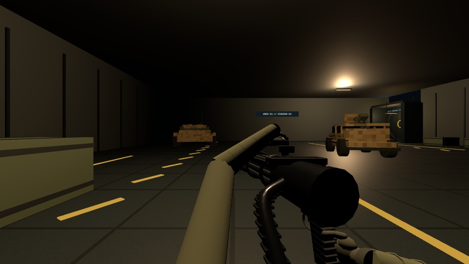 | 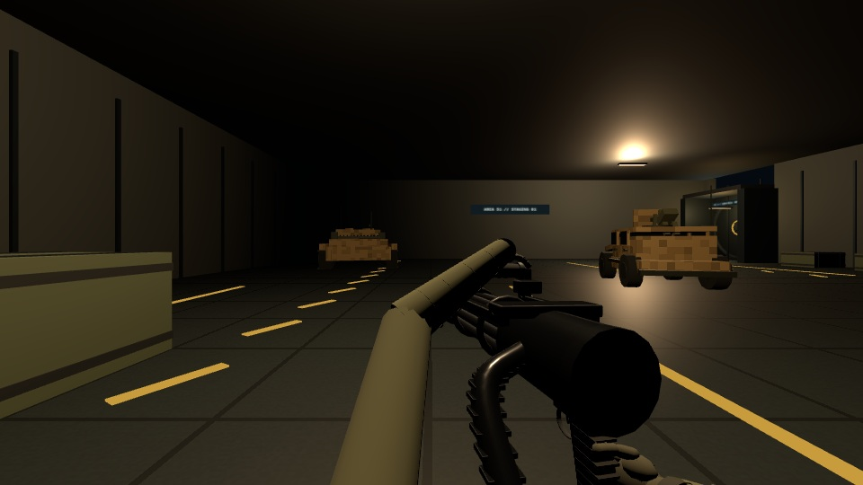 |
| idle-hud | 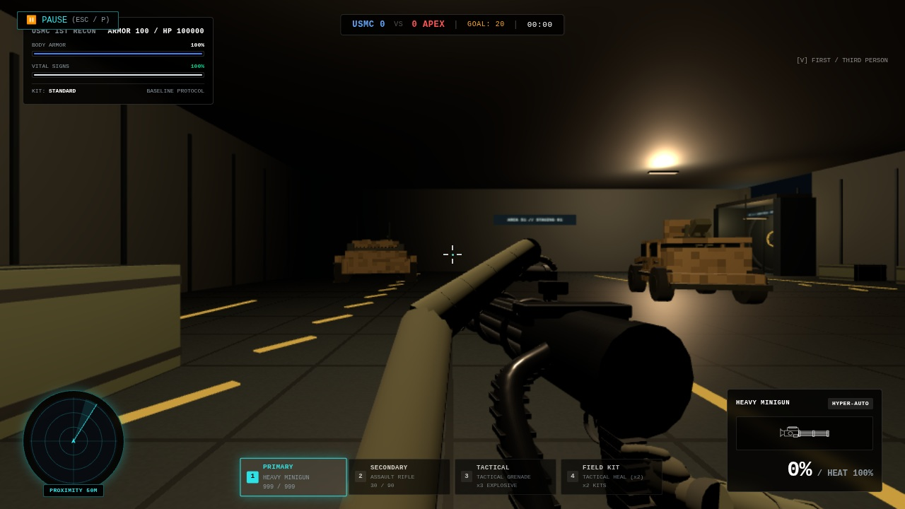 | 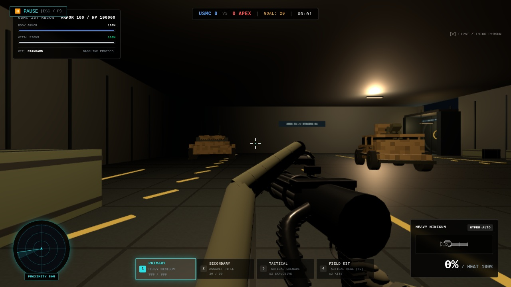 |
| walking | 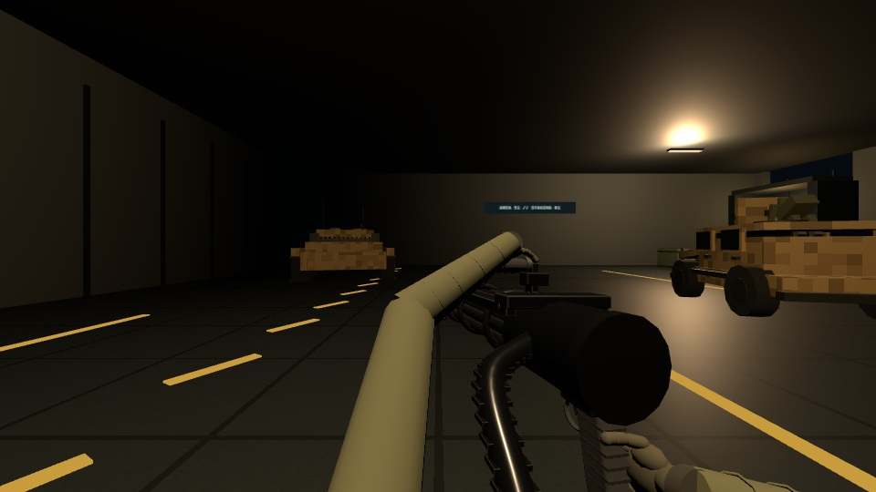 | 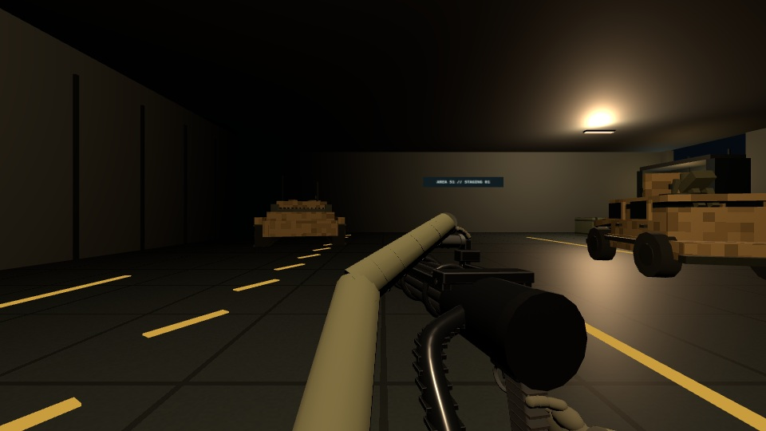 |
| sprint-entry | 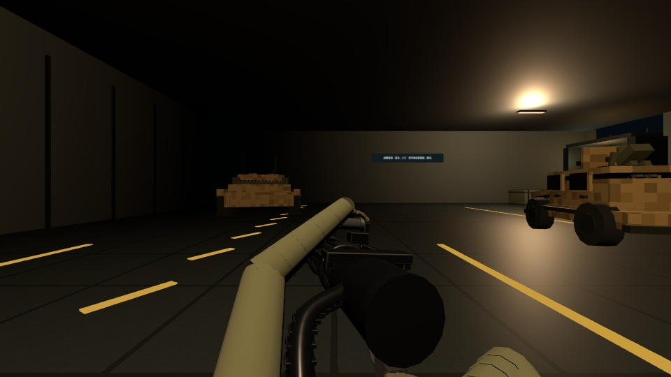 | 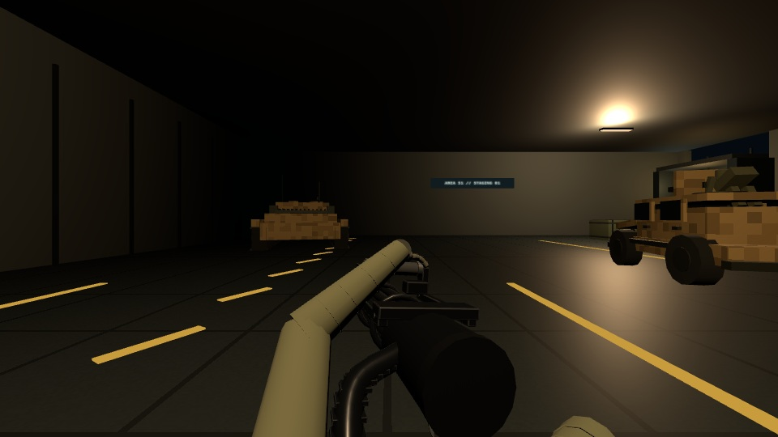 |
| sprint-held | 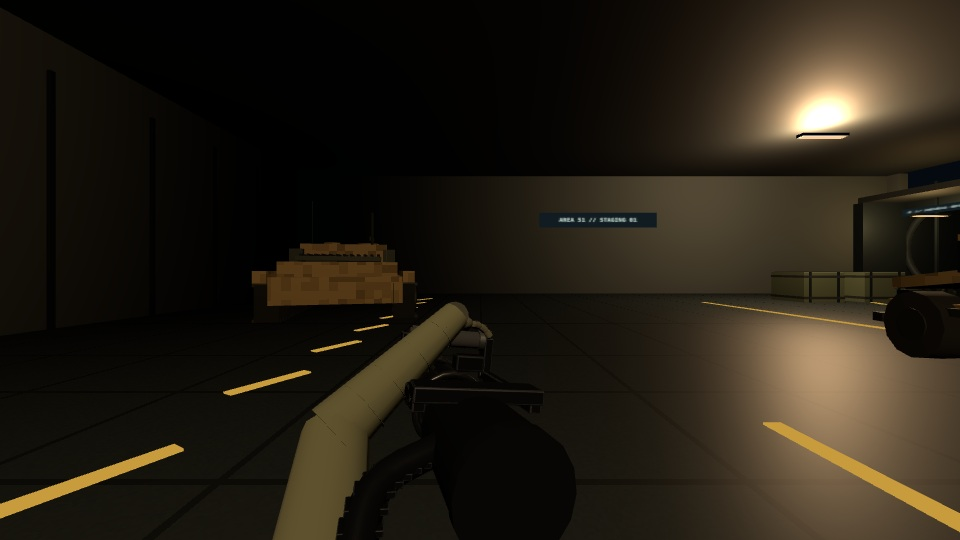 |  |
| movement-recovered |  |  |
| ads | 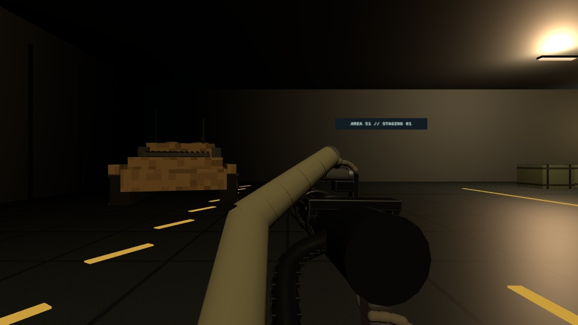 | 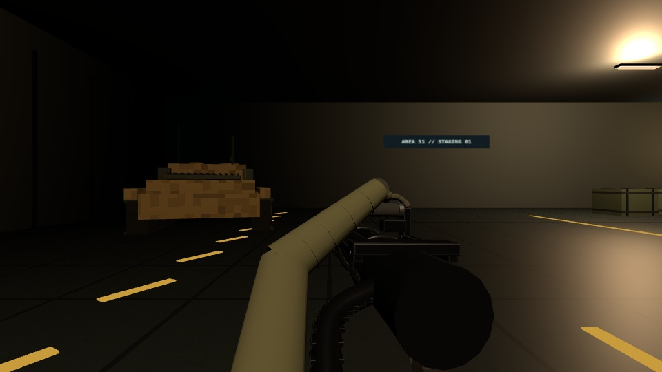 |
| firing | 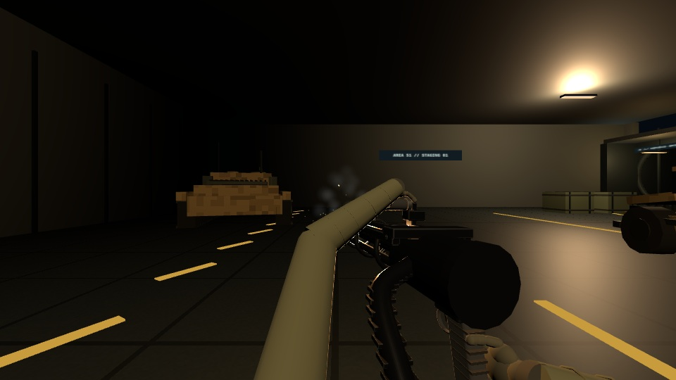 | 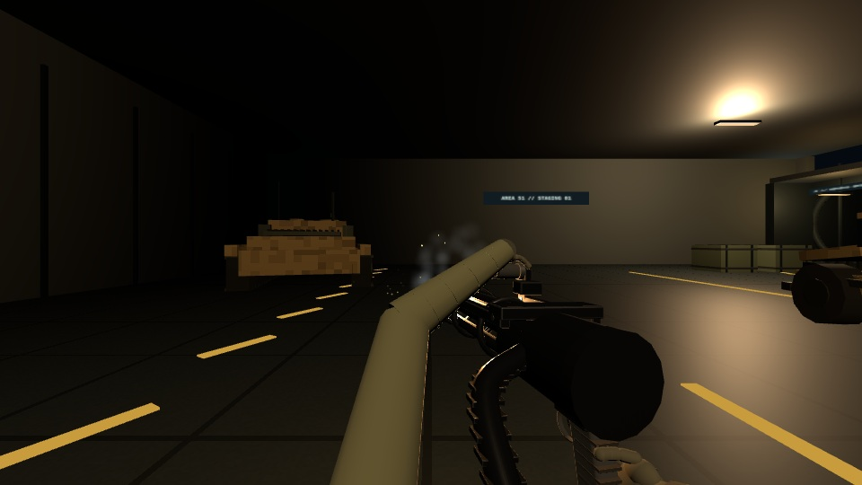 |
| heat-reaction | 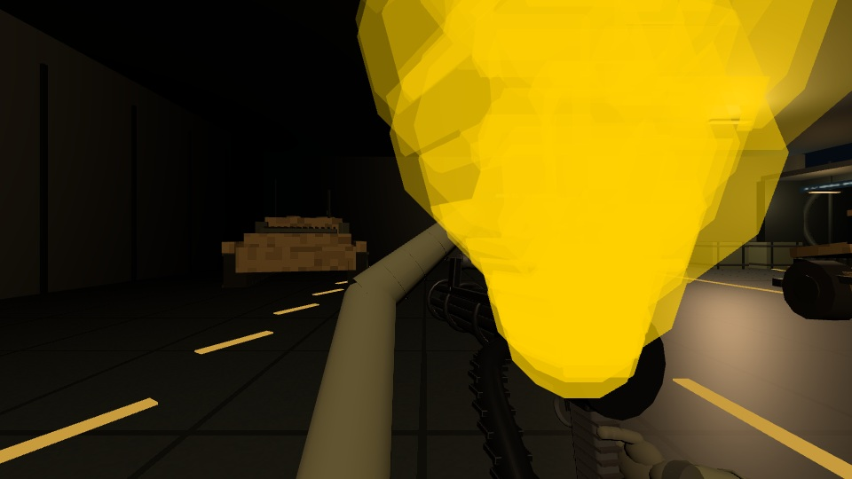 | 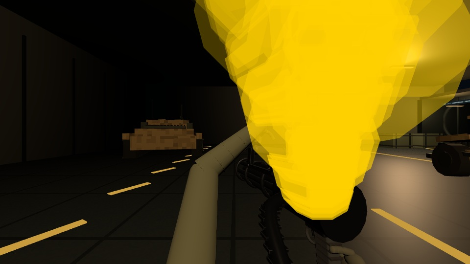 |
| heat-recovered |  |  |
| re-equipped | 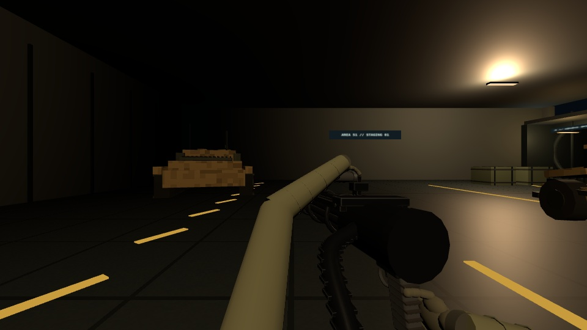 | 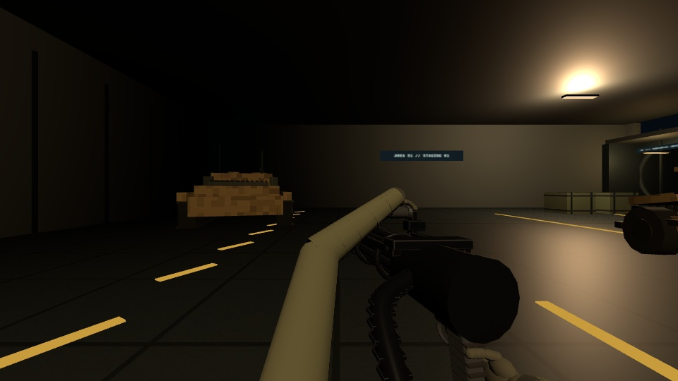 |

[Comparison assertions](comparison.json), [baseline samples/cameras](before-positioning.json), [corrected samples/cameras](after-positioning.json).

The sequence exercises walking, sprint entry/hold/recovery, ADS, real firing, the existing heat/reload action and recovery, and switching to the assault rifle and back. Both runs fire 21 shots. All sampled gameplay values, root X/Z/rotation and local hand transforms match (hand floating-point tolerance 1e-12); every root Y differs by exactly -0.03 m. Both runs have no browser errors. The idle HUD capture confirms the weapon remains visible.

Reproduce using `/usr/bin/chromium` and `MINIGUN_POSITIONING=1 MINIGUN_MAP=area51 CHROMIUM_PATH=/usr/bin/chromium MINIGUN_OUTPUT=/tmp/w04-position node scripts/test-minigun-hold-browser.mjs`. For before captures, point `MINIGUN_ROOT` at an archived 901d2ab source checkout with dependencies available. The added mode is test-only and does not enter the production bundle.

## Regression results

All required commands completed with exit code 0; full output is in [checks](checks) and [results.json](checks/results.json):

- `npm run lint`
- `npm run build`
- `npm run test:minigun`
- `npm run test:viewmodel`
- `npm run test:weapons`
- `npm run test:runtime`
- `npm run test:performance`

The build retains its existing large-chunk warning. `git diff --check` passed. Production output contains no browser-harness hook.

The existing Minigun suite checks surface/contact and sleeve clearance, continuous poses, barrel rotation, heat/cooling, recoil and bounded object/material ownership. [Gun geometry/material hashes](preserved-geometry.json) match the baseline in first and third person (the comparator excludes its documented upper-sleeve clothing meshes). [Other-weapon pose hashes](preserved-other-weapons.json), including sprint, match for all eleven other weapons. [Source preservation](preserved-sources.json) confirms the model/hand/camera/world/bot sources and Minigun tests are byte-identical; the sole runtime source change is the final Minigun translation in weapons.ts. Rocket Launcher, Grenade Launcher, Engineer tripod and environmental audio are unchanged.

## Files and limitations

[Exact changed-file manifest](changed-files.txt). Runtime: `src/weapons.ts`; reproducible capture mode: `scripts/test-minigun-hold-browser.mjs`; this report and its images, raw samples and check logs.

The user-referenced latest gameplay screenshot was not attached in this session, so comparisons use the exact verified branch baseline. These are local actual-App browser captures with controlled stepping, not a native interactive GPU performance or audible motor assessment. Automated regression checks passed; hosted gameplay has not been visually tested. The existing large yellow cooling plume obscures part of the heat-reaction shot and is preserved. Native visual approval by the developer remains outstanding. PR #29 stays draft; no main merge, production promotion, W05 or W06 work is included. The latest preview URL is recorded in PR #29 after the branch push.
