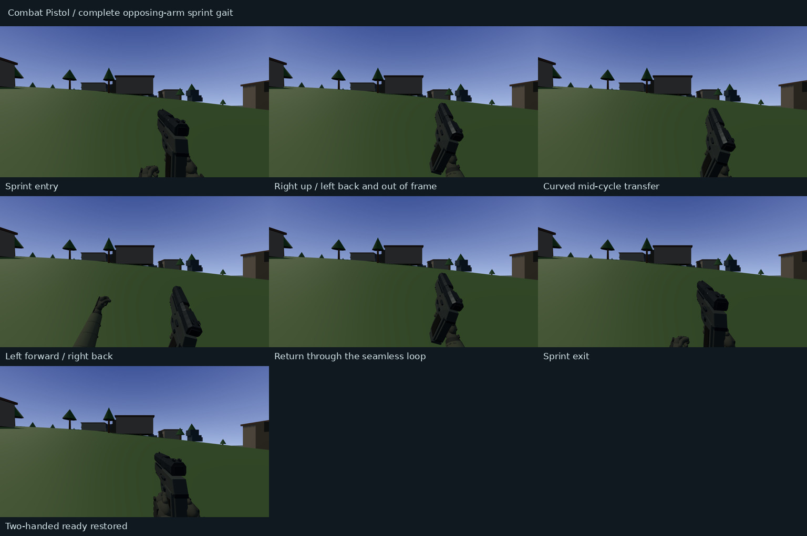

# Combat Pistol sprint biomechanics — PR #20

Latest: [final animation tuning and real-time evidence](../pistol-sprint-tuning/README.md) supersedes this checkpoint's cadence and arm ranges. The report below records the earlier authored-gait implementation.

The former sprint combined a low-frequency sine wrist path with additional weapon bob, a mostly static elbow target, and an independent third-person oscillator. Its visible hand motion did not establish a coherent shoulder/elbow-driven stride pair.

This pass changes sprint presentation only. The approved CP-9 model/materials, firing, recoil, ADS alignment, tactical/empty magazine choreography, audio, ammunition, other weapons, input restrictions, movement/physics, maps and bots remain intact. Original local work and unpublished evidence were preserved in backup commit `79d1521d8699423b39e06008ee97ee75c278fde1`.

## Shared gait and cadence

`src/pistolSprint.ts` owns the configuration, normalized phase, poses and evaluator. One cycle is a **complete left/right stride pair**. At the established 8.6 m/s sprint speed it runs at 2.05 pairs/s, or 4.10 footfalls/s. Cadence scales with the square root of actual horizontal speed, with conservative bounds. The previous `sin(bob * .5)` arm period was about 1.11 pairs/s; legacy camera and weapon bob used other frequencies.

| Pair phase | Right arm/pistol | Left arm |
| --- | --- | --- |
| 0–11.5% | Forward/up drive, bent elbow, close carry | Back/down, naturally outside frame |
| 25.5% | Lowering through neutral | Recovering forward on a curved path |
| 39.5–51.5% | Back toward right hip | Forward/up drive into lower-left view |
| 64–78% | Accelerating forward again | Recovering back/down |
| 91–100% | Approaches next forward drive | Approaches rear limit; seamless wrap |

Closed quintic Hermite tracks have nonuniform landmark timing, monotone harmonic velocity tangents and matching position, velocity and acceleration across each landmark and the loop seam. These drive shoulder pitch, elbow flexion, torso counter-rotation and fist twist. They are not a set of snapped poses or enlarged sine waves. Trigonometry is used for forward kinematics, not as a wrist oscillator.

## Arm constraints and weight

The virtual shoulder rotates a fixed 0.26 m upper arm; elbow flexion places a fixed 0.285 m forearm/wrist. Right elbow flexion varies around 93–108 degrees; left flexion varies around 81–88 degrees. Both elbows move with their wrists. The existing rendered sleeve is solved from the same elbow toward the cuff, with the existing independent sleeve-length cap. No upper-arm rebuild, stretched sleeve, new per-frame object or new GPU resource is introduced.

The right wrist and its grip quaternion constrain the weapon root: `rootPosition = rightWrist - rotatedGripOffset`. The right hand therefore cannot slide relative to the pistol. The left wrist/orientation remain independent in camera space and are converted into weapon space after the weapon root pose. Its relaxed fist twists with the forearm. Its back/down phase leaves the viewport through actual motion; visibility is never toggled to hide the hand.

Three layers share one phase: the primary shoulder-driven opposing gait; two small 6 mm footfall compression/rebound pulses per pair plus subtle torso counter-rotation; and a bounded 35 ms phase-domain wrist lag around shoulder reversal, applied to the hand/weapon constraint together. Pistol-specific generic sprint bob is removed. Existing cosmetic camera bob fades down with the gait; no new gameplay-camera rotation or displacement is added. All other weapons retain their existing bob and carry paths.

## Transitions and third person

A closed-form critically damped envelope gives continuous position and velocity on entry/exit and behaves consistently across frame rates. Fully stopped entry begins at the authored forward-drive landmark rather than a random idle-bob phase. An interrupted recovery can resume without resetting a still-visible pose. Pause returns before clock/blend/bone updates; switching, death and redeploy reset the controller.

ADS, stop/crouch and airborne states blend out. Landing can resume a valid grounded sprint. Reload hand interactions always take priority: the support hand uses the approved magazine/control paths, while only the first 80 ms of the authoritative eject clock absorbs any remaining carry. Standalone reload trajectories/timing are unchanged.

The local third-person actor reads the **same** phase-derived shoulder/elbow angles and envelope from the viewmodel manager. Its pistol remains attached to the right forearm. Bot and faction animation logic is unchanged.

## Validation and rendered evidence

Passed: TypeScript lint, build, pistol sprint, existing pistol mechanics, weapons, viewmodel, controls, audio, Battle Rifle, sniper and shotgun suites. The input harness was extended to supply the manager's new read-only presentation getter. Build retains the existing Vite bundle-size advisory.

Focused tests continuously sample the full cycle, all key/seam crossings, quaternion continuity, finite acceleration, arm opposition, curved trajectories, bone lengths, dynamic elbows, weapon grip constraint and natural viewport cropping. Equivalent-time poses agree at 30/60/144 Hz. State tests cover speed-scaled cadence, entry/exit, stop, ADS, air/landing, reload, switching, pause, death and reset. Shared tests retain near-plane and resource/disposal coverage. No final local checks fail.

The source checkpoint is `5d0dd1b9d001a67144733a6c05847740e5c775bf`; the final review commit adds these evidence files/documentation only. Every uploaded source file was checked against its local Git blob hash. Approved model, reload/audio, grip configuration, gameplay types, bot/world code and game-loop files have no changes from the prior accepted PR head.

[Continuous two-second sprint cycle — MP4](evidence/sprint-cycle.mp4) · [Sampled transforms and validation details](evidence/validation.json)

The clip contains 48 actual App-scene/camera renders at a clock-stepped 24 FPS, covering more than four complete stride pairs. The seven stills show entry, both opposing drive extremes, neutral transfer, loop return, exit and restored two-handed ready. This uses the real game/viewmodel rendering path, not an isolated model viewer. SwiftShader wall-clock speed is not evidence of native-GPU animation feel; final laptop/native-GPU acceptance remains with the user. First-person framing is the primary visual validation; third-person uses the shared gait but has not received a separate rendered acceptance capture.

Reproduce focused tests with `npm run test:pistol:sprint`. Reproduce the bounded render with `PISTOL_GAIT=1 PISTOL_OUTPUT=work/pistol-gait npm run test:pistol:browser`. `BENCHMARK_BROWSER` selects the Chromium executable. No Area 51/APEX loading benchmark was run.

## Review scope

Branch: `feat/pistol-fidelity-one-handed-sprint`. Existing [draft PR #20](https://github.com/fcootes/Gun-Arena-V2/pull/20), targeting `main`. No merge, production deploy/promotion, new Vercel project or deployment-protection change.

[PR preview](https://gun-arena-v2-git-feat-pistol-fidelity-one-handed-sprint-fcootes.vercel.app). Vercel's GitHub commit status confirms successful deployment of the source checkpoint. The final evidence head is checked separately in the PR. Direct Vercel deployment-inspection API access is still blocked by team-scope HTTP 403; the exact-head association is established through Vercel's status on the GitHub SHA.

Changed implementation files: `src/pistolSprint.ts`, `src/pistolMechanics.ts`, `src/viewmodelHands.ts`, `src/weapons.ts`, `src/App.tsx`. Tests/tooling: `tests/pistolSprint.test.ts`, `tests/pistol.test.ts`, `tests/viewmodel.test.ts`, `tests/inputHarness.mjs`, `scripts/test-pistol-browser.mjs`, `package.json`. Documentation: this folder and the prior pistol overview's sprint/evidence links.

Stop for visual acceptance. Native-GPU feel and subjective running posture require the user's review.
