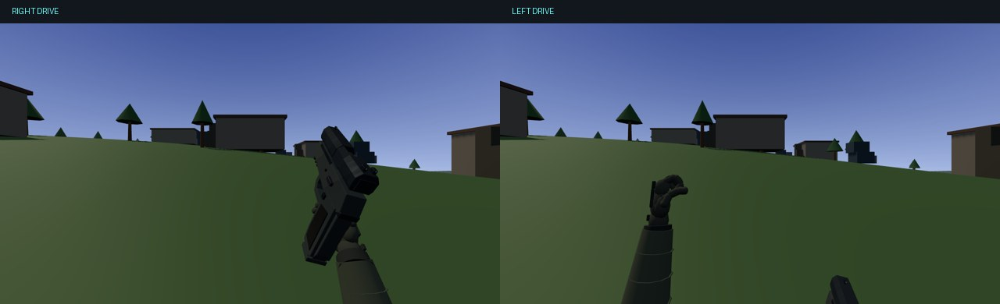

# Combat Pistol sprint — final animation tuning

Focused refinement of draft [PR #20](https://github.com/fcootes/Gun-Arena-V2/pull/20), based on the user's laptop gameplay review. Baseline: `acf4182915b4f2f7295be2dbcbd564e8412bff34`. The closed C2 curves, fixed-length two-bone FK, independent left arm, right-hand grip constraint, torso response and time-based controller are preserved.

## Revised motion

| Reference-speed measurement | Before | Revised |
| --- | ---: | ---: |
| Full alternating stride pairs per second | 2.05 | 1.75 |
| Compression/footfall pulses per second | 4.10 | 3.50 |
| Right wrist depth travel between drive extremes | 7.56 cm | 14.07 cm |
| Right wrist vertical travel between drive extremes | 6.00 cm | 33.95 cm |
| Left wrist vertical travel between drive extremes | 34.18 cm | 45.54 cm |
| Left forearm tilt from upright at forward apex | 51.18° | 11.55° |
| Left fist forward-apex camera-local Z | −60.71 cm | −45.18 cm |
| Entry / exit damping time parameters | 95 / 65 ms | 115 / 80 ms |

Measurements include the unchanged torso/compression layer at authored phases 0.115 and 0.515. See [raw before/after measurements](evidence/measurements.json). Damping parameters are not total transition durations: the critically damped envelope approaches its target over several time constants.

Right shoulder pitch now spans −0.33 to +0.77 radians, with the elbow flexed 1.78–1.82 radians. Its forward/up drive brings the pistol closer and higher; recovery moves the elbow rearward and lowers the pistol toward the right hip, naturally below the screen at its deepest point. Weapon pitch follows the larger shoulder drive while retaining the bounded 35 ms inertia layer. Gun and firing hand still move as one constrained assembly.

The left upper-arm swing changes modestly, from −0.31…+0.83 to −0.32…+0.90 radians. Coordinated elbow flexion now spans 1.55…2.05 radians, placing the forward fist 27.92 cm above its elbow with only 5.42 cm of forward forearm projection. This produces the nearly upright forearm through articulation; there is no extra wrist translation. The original rear/downward wrist position is effectively retained. Fist twist and finger articulation are unchanged.

Both shoulders use the same existing opposing drive tracks. Compression retains two pulses per pair, and inertia retains its duration in seconds as cadence slows. Local third-person arms still read the production pose directly. Its leg stride is normalized by the new right-shoulder range, retaining the previous 0.425-radian leg amplitude and shared phase instead of amplifying the legs with the larger arm pump. There is no active footstep audio scheduler in the inspected gameplay path; no new audio events were added.

Only `src/pistolSprint.ts` tuning constants/formulas and the local pistol leg normalization in `src/App.tsx` change production behavior. Hand rig, grip attachments, model/materials, firing, reloads, audio, slide/magazine mechanics, ADS, ammo/damage, movement speed/physics, other weapons, maps and AI are unchanged by this tuning pass. No new runtime geometry, resources or per-frame allocations.

## Visual evidence

[Right drive](evidence/right-drive.jpg) · [Left drive](evidence/left-drive.jpg) · [Eight-second real-time recording](evidence/sprint-realtime.mp4) · [Timing samples](evidence/realtime-timing.json)

The MP4 lasts **8.08 seconds**, with **81 actual rendered frames** at about **10.0 render FPS** (640×360). It captures the live production manager on requestAnimationFrame using actual elapsed wall time: half a second ready, seven seconds sprinting, then recovery. The fixture consumes elapsed time in bounded catch-up steps so the production manager's large-dt guard cannot slow the gait on this software renderer; recorded phase increments are asserted against measured wall time. Original variable capture timestamps are preserved when encoding. The game background and camera are held still, HUD compositing and dynamic shadow rendering are disabled only in this fixture to reduce rendering cost, and the actual pistol/hand geometry, lighting, grip constraints and animation remain live. This environment could not produce a native 60 FPS recording. The capture remains choppy and cannot establish native-GPU smoothness; the user's laptop preview review remains necessary.

The seven full-scene screenshots cover entry, right drive, neutral transfer, left drive, loop return, exit and restored two-handed ready. The additional [two-second deterministic continuity clip](evidence/sprint-cycle.mp4) remains clock-stepped at 24 FPS and is separate from the real-time recording. Screenshots use the real App scene and camera; the WeaponStudio viewer is not used.

## Validation

Passed TypeScript lint, production build, pistol sprint, pistol mechanics, viewmodel, weapons, controls and audio tests. Build retains the existing bundle-size advisory.

The focused gait suite samples 2,049 poses, all C2 landmark/seam crossings, fixed bone lengths, elbow flexion, quaternion continuity, curved paths, shoulder opposition, grip contact and the revised anatomical targets. Both wrists and phases agree at equivalent half-second points throughout six seconds at 30, 60 and 144 FPS. Full weapon, sleeve and instanced-finger geometry is checked throughout entry and multiple full cycles at each rate. The torso-side sleeve ends can leave the camera below the near-plane frustum; the pistol, wrists and fingers remain in front of the near plane. Existing tests cover resource reuse, tactical/empty reloads, sprint fire blocking, ADS priority, pause, air/landing, stop, switching, death/reset and controls.

Local third-person phase consistency was inspected in source: it reads the same cached pose, with no independent sprint clock. A separate third-person acceptance recording was not captured.

Reproduce: `npm run test:pistol:sprint`; `PISTOL_GAIT=1 PISTOL_OUTPUT=work/pistol-tuning npm run test:pistol:browser`. Real-time capture uses actual requestAnimationFrame elapsed seconds with timestamped canvas frames. It never advances the gait by an assumed recording frame interval. The browser fixture is test-only; it is not shipped in the game.

## Delivery

Branch: `feat/pistol-fidelity-one-handed-sprint`, existing draft PR #20 targeting `main`. Preview: https://gun-arena-v2-git-feat-pistol-fidelity-one-handed-sprint-fcootes.vercel.app . Vercel's GitHub status reports successful deployment of source checkpoint `a9f653ebfc67d6db5e39e70bcd24c9aa1418ee04`; the final evidence commit is checked separately in the PR. Direct deployment inspection returned team-scope HTTP 403 again; a successful GitHub Vercel status establishes a deployed SHA but does not establish browser access to that deployment. No merge or production promotion.

Stop for the user's laptop visual review of cadence, weight and framing. [Future recommendations](FUTURE-WORK.md) are audit-only.
