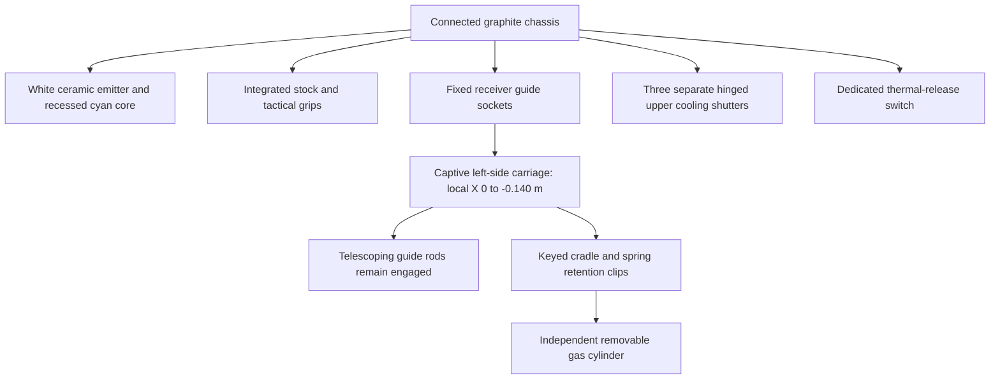

# W03 — PR-100 Tactical Plasma Repeater

The approved PR-100 panels **1–2** define the exterior: an asymmetric white ceramic emitter, dark graphite receiver, compact sight rail, skeleton stock, tactical grips and cyan side gas cylinder. Panels **3–4** are mechanism references only. Their older rifle silhouette is not used. Panel **5** becomes a separate upper-shutter thermal action with the cartridge tray closed. Panel **6** becomes discrete projectiles, with no continuous beam.

Internal ID remains `laser` for saved loadouts and AI compatibility; player-facing name is **PLASMA REPEATER**. Based on main `6dd3b2d`, including merged Railgun PR #24. W03 remains a draft until laptop approval; no merge or production promotion.

## Model and mechanism

The fixed guide sockets overlap the moving rods at full extension. The cylinder is longitudinally aligned in the cradle, independently lifted and carried away by the support hand. A separate fresh cylinder enters the same seat; visibility transfers to the cradle-owned cylinder at the seating transaction. No cylinder or carriage is reparented per frame. The same factory supplies Armory, first person, bots and local third person, preserving the white emitter in all views. Static details are batched; the bare weapon remains below the existing 24-mesh budget.

The firing hand stays at the grip while the left hand targets the latch, moving handle, cylinder and separate thermal switch using full part-to-weapon transforms. Reload presentation rolls inward 12.6° without an exaggerated forward thrust. The pre-existing full-body third-person arm pose is retained; articulated weapon parts share the actual action state.

## Firing, damage and resources

- Maximum **8 individual bolts/sec**, authoritative **0.125 s** simulation interval. At most two due shots after a stall; excess backlog is discarded. AI difficulty may slow cadence, never increase it above 8 Hz.
- **60 charges installed + 180 reserve** (three complete spare cylinders). One successfully acquired projectile consumes one charge. A rejected pool acquisition consumes nothing. No hitscan damage occurs at trigger time.
- Projectile speed **200 units/sec**, maximum travel **130 units**, lifetime at most **0.70 s**. Base player damage **12** with the retained **1.7×** headshot multiplier. Close-range theoretical DPS is 96, close to the old 5-damage/.055 s beam's 91 DPS. Existing plasma range falloff remains full through 60 units, falling to 40% at 120 units. Shields, armour, hitmarkers, attribution and kills use existing handlers.
- Each shot adds **2.5 heat**. Uninterrupted full-rate fire overheats on shot 40, at approximately **5.0 s**, leaving 20 charges. Idle cooling begins after a .15 s grace period at **16 heat/sec**. Heat and cartridge supply are independent.
- Overheat blocks firing and automatically starts the thermal action. Full recovery clears heat and the overheat latch; it never refills ammunition. Cartridge replacement receives ordinary passive cooling, not an automatic heat reset.

A sealed tactical replacement discards remaining old charges at removal (1.42 s), consumes exactly **60 reserve** at seating (1.86 s), and installs 60 new charges. It is not a top-up. Existing arbitrary pickup packets are explicitly reconciled: a positive 1–60 charge packet grants one full sealed cylinder; larger packets round up to complete cylinders. Existing partial reserve values are rounded down to complete spares when a cartridge replacement begins; thermal venting preserves even legacy partial reserve counters. Area 51, Shattered Wall, legacy world pickups, support packs, AI support resupply and facility refills all use complete-cylinder resources. Support packs are removed after collection to prevent repeated grants.

## Actions and R precedence

| Cartridge replacement | Base seconds |
|---|---:|
| Present | 0.00–0.22 |
| Unlock latch | 0.22–0.45 |
| Slide carriage left | 0.45–0.87 |
| Restrained exposed-chamber cooling pulse | 0.87–1.07 |
| Lift and remove old cylinder | 1.07–1.42 |
| Retrieve, align and seat fresh cylinder | 1.42–1.86 |
| Push carriage back on the same rails | 1.86–2.32 |
| Lock and activate | 2.32–2.54 |
| Return support hand and weapon to ready | 2.54–2.80 |

Thermal recovery is a separate **1.25 s** action: present .15, switch .15, shutters open .20, controlled vent .50, shutters close .15, recover .10. The tray, latch and installed cartridge stay closed and retain their ammunition throughout. Class duration modifiers apply once to either action.

R ignores an existing action; otherwise overheat recovery has priority, then empty cylinder replacement if a spare exists, then vent at heat ≥65%, then partial-cylinder replacement, then venting a full cylinder at meaningful heat ≥10%. Otherwise it does nothing. No new keybind is added.

Cancellation restores a valid closed mechanical state. Before removal, the original supply is retained; after removal and before seating, the weapon remains empty; after seating, the committed new cylinder and consumed spare remain. No refund or duplicate transfer occurs. Overheated weapons resume recovery when selected. Pause freezes the action and pauses audio; death, weapon switching and teardown cancel effects through existing lifecycle paths.

## Projectile collision and performance

`plasmaProjectiles.ts` owns a session pool of **192** bolt slots and **32** contact-flash slots. Two instanced bolt meshes and one instanced impact mesh reuse static geometry/materials. No mesh, geometry, material or light is constructed per shot. A bolt has a compact bright core, a short translucent halo and a fading contact effect; there are no per-bolt shadow lights or a persistent cylinder.

Every step compares the segment against active solid world bounds, real world/bot hit meshes and terrain. The nearest collision wins; solids win equal-distance ties. Moving actors additionally use relative swept body/head bounds between their sampled positions, catching crossings between frame endpoints. Allies physically stop a bolt without taking damage, and the owner is excluded. Muzzle placement converges on the crosshair; an eye-to-muzzle solid check prevents firing through nearby cover when the muzzle protrudes beyond it.

The same pool and collision resolution serve player and bots. Bot accuracy perturbs aim; difficulty scales damage and may slow firing, replacing probabilistic instant damage for this weapon. A bolt deactivates immediately on one impact or expiration and releases its owner reference. Reset clears every bolt, impact and sampled actor reference. Unmount disposes instanced buffers, geometry and materials once.

## Audio

Existing WAVs are unchanged. Eight-Hz firing uses `plasma_fire_single.wav` (.165 s) with bounded overlap; the old automatic beam loop is neither played nor preloaded for this weapon. The existing cylinder-insert recording plays at the real 1.86 s seating contact. A native-rate segment of the existing cooling hiss follows the thermal opening/closure window, with class scaling, late-cue handling, pause and cancellation. The old composite reload is not reused for unidentified mechanical contacts.

Typed silent contacts are exposed through `PlasmaListener`: tray unlock, tray open, cooling pulse, cylinder removal, cylinder seating, tray closure, tray lock, thermal open and thermal close. [W07 audio follow-up](audio-follow-up.md) lists missing dedicated recordings. No sound scouting or new audio acquisition occurred.

## Evidence and review

See [screenshots and recordings](evidence/) and [verification](verification.txt). Armory includes **TEST CARTRIDGE**, **TEST THERMAL VENT** and discrete muzzle-fire preview controls.

The normal-speed MP4 is an offline 30 FPS export of the actual App renderer, production action clocks, hand rig and projectile pool using Area 51 lighting and a stationary world. Each action is continuous; the video cuts between reload, vent and firing demonstrations. It establishes animation/simulation behaviour, **not real-time GPU performance**. Separate unretimed live-input footage and measured wall duration make that distinction explicit. Laptop visual acceptance, full-scene native performance and final weapon feel remain for the user to approve.
