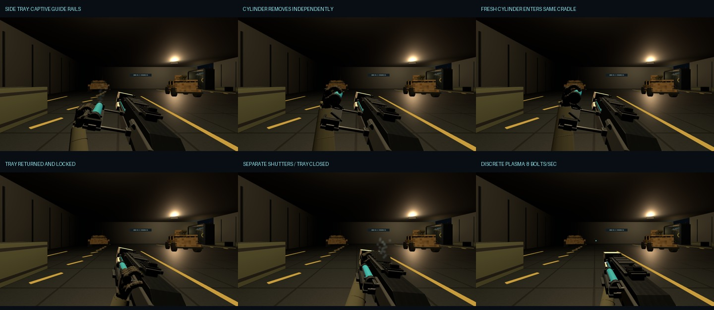

# PR-100 model and gameplay evidence

- [Normal-speed video: reload → vent → discrete firing](reload-vent-fire-normal-speed.mp4). 167 frames at 30 FPS, 5.567 s. Each action is continuous; cuts separate the demonstrations. The actual App renderer, production action clocks, hand rig and projectile pool are exported offline with Area 51 lighting and a stationary world. This is not real-time GPU performance evidence. [Frame-by-frame state provenance](video-provenance.json).
- Armory: [closed side](armory/armory-ready-side.png), [closed three-quarter](armory/armory-ready-three-quarter.png), [connected extended tray](armory/armory-tray-open.png), [old cylinder lifted](armory/armory-old-cylinder-out.png), [fresh cylinder](armory/armory-fresh-cylinder.png), [separate upper shutters](armory/armory-thermal-shutters.png).
- First person: [presentation](gameplay/ready-presentation.png), [extended tray](gameplay/tray-extended.png), [cylinder removal](gameplay/old-cylinder-raised.png), [insertion](gameplay/fresh-inserting.png), [seat](gameplay/cartridge-seated.png), [return](gameplay/tray-return.png), [locked](gameplay/locked.png), [thermal vent](gameplay/thermal-vent.png), [discrete firing](gameplay/discrete-fire.png), [projectile flight](gameplay/projectile-flight.png).
- [Live input verification](live/live-validation.json) and [unretimed reload capture](live/live-reload-unretimed.webm). The raw full-scene software-WebGL run took **152.33 wall seconds** for the 2.8 s simulation, and precedes the last shutter/contact visual polish. Use the regenerated MP4/model stills above to review final geometry; raw footage establishes actual input execution and the performance limitation.
- [Actual App fixed-step 30/60/144 Hz results](live/scene-rates.json): exactly eight bolts, eight consumed charges and 20 added heat per simulated second at each rate. These are simulation rates, not measured GPU frame rates.
- [ADS](live/live-ads.png), [sprint](live/live-sprint.png), [local third person](live/third-person.png). The shared white emitter is preserved; the existing body-arm rig remains its legacy pose.
- [TypeScript, build and test transcripts](checks/), [pass/fail report](../verification.txt), [unchanged audio hashes](../preserved-audio.json), [W07 sound gaps](../audio-follow-up.md).

Native-laptop appearance, feel and rendering performance require user acceptance. PR remains draft; no merge or production promotion.
