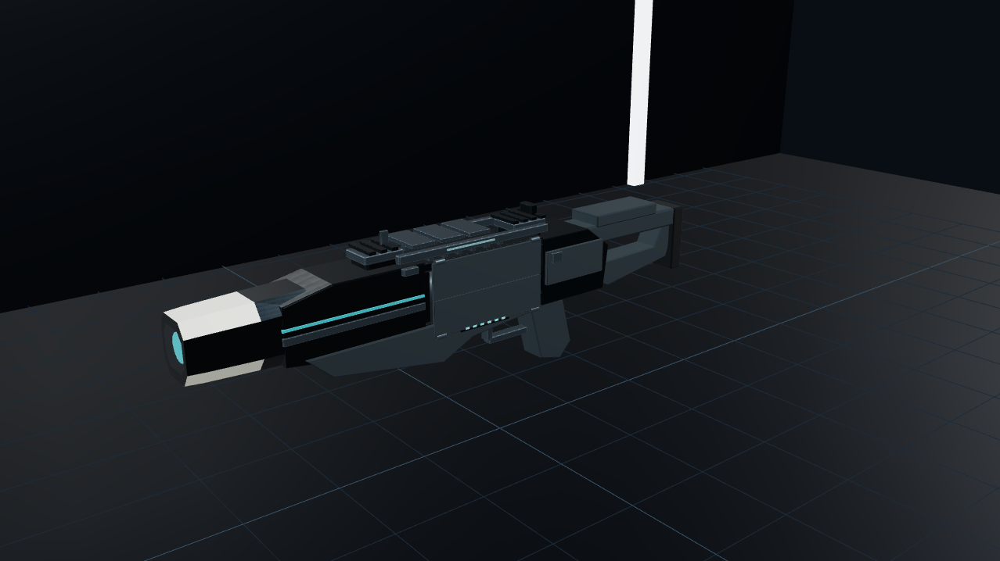

# Current PR-100 implementation evidence

All images are actual Three.js renders of this branch. No concept art or generated imagery is used as implementation evidence. The old `../evidence/` directory is the superseded external-tray baseline.

## Videos

- [2.20-second reload, continuous with ready footage before and after](reload-2p20s.mp4)
- [Independent 1.25-second thermal vent](thermal-vent.mp4)
- [Discrete bolt firing](discrete-fire.mp4)
- [Combined sequence](reload-vent-fire-normal-speed.mp4)
- [Frame-by-frame production state provenance](video-provenance.json)
- [Unretimed live input reload](live/live-reload-unretimed.webm) and [live controls/audio report](live/live-validation.json)

**MP4 provenance:** offline 30 FPS simulation playback of the actual App renderer, production reload/hand/projectile code and Area 51 lighting. World held stationary; actions are not shortened or retimed. Reload has .5 s ready bookends around its 2.20 s action; vent has matching bookends around 1.25 s. Videos are silent. This is not proof of native laptop GPU performance. The separate live RAF capture is unretimed software WebGL at 640×360, taking 29.5076 wall seconds for the reload simulation.

## Model views

| Required view | Actual render |
|---|---|
| Closed left profile | [Left side](armory-ready-side.png) |
| Closed three-quarter | [Three-quarter](armory-ready-three-quarter.png) |
| Right profile / rear quarter | [Right](armory-right-side.png), [rear](armory-rear-quarter.png) |
| Integrated front aperture | [Emitter close-up](armory-front-emitter.png) |
| Cylinder inside open chamber | [Internal cylinder](armory-internal-cylinder.png) |
| Connected hinges / opposing panels | [Hinge view](armory-hinges.png) |
| Cylinder fully clear | [Ejection](armory-fully-ejected.png) |
| Empty internal seat | [Empty cavity](armory-empty-chamber.png), with spent/fresh cylinders outside the chamber |
| Direct fresh insertion | [Insertion](armory-fresh-cylinder.png) |
| Final seat | [Seat](armory-seating.png) |
| Fully flush panels | [Closed panels](armory-doors-flush.png) |
| Six full cyan segments | [Full](armory-ammo-full.png) |
| Partial ammo | [35 charges](armory-ammo-partial.png) |
| High heat independent of full ammo | [96% heat](armory-heat-high.png) |
| Thermal shutters / closed cartridge panels | [Vent](armory-thermal-shutters.png) |

## First-person views

[Ready](ready.png) · [thumb press](thumb-press.png) · [doors open](panels-open.png) · [ejection](fully-ejected.png) · [empty chamber](empty-chamber.png) · [fresh insertion](fresh-inserting.png) · [slap](seating-slap.png) · [seated](cartridge-seated.png) · [closing](panels-closing.png) · [locked](locked.png) · [thermal vent](thermal-vent.png) · [recovered](vent-recovered.png).

[Pose states](poses.json), [30/60/144 Hz actual App results](scene-rates.json), [real Armory buttons and repeated GPU-resource counts](armory-controls-memory.json), [test transcripts](checks/) and [verification/limitations](../verification.txt).

The native-laptop visual review belongs to the developer. PR #26 remains draft.
