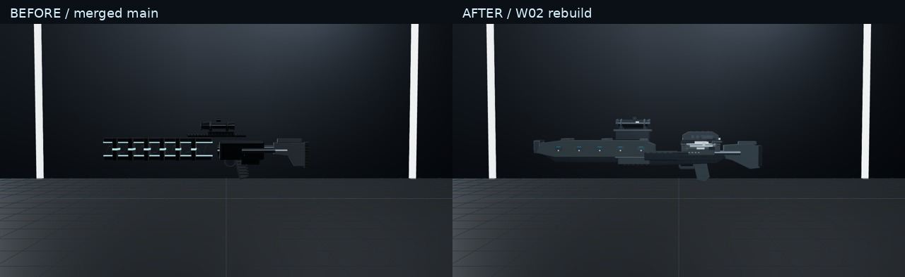

# W02 Tactical Railgun fidelity

The old open ladder and removable battery reload are replaced by a new reinforced kinetic accelerator and a real, captive upper-rear sliding breech. The player loads one metal slug into an exposed V-block chamber. A small spent conductive carrier ejects separately. The standard player reload takes **2.80 seconds**, including final recovery.

Based on main `3be03e3a8ed03245b2acf391fce5ed1a6ec45d9c`, after merged LMG PR #23. This work is for draft review under Issue #16. Native-laptop visual approval remains outstanding.

## Mechanical layout

All model coordinates are metres; forward is local **−Z**, up is +Y. The integrated lower keel carries the twin rails, five paired coil modules, protected side armour, fixed capacitor banks, power buses and a reinforced muzzle termination. The new stock, grip and open trigger guard share this assembly. Bevelled profiles, inset surfaces, fasteners, grip serrations and witness marks are baked by material inside stable articulated groups.

The rear chamber spans approximately Z +0.03…+0.22. Its scalloped near-side sill leaves the actual loading/ejection space open. The 31 mm diameter steel slug seats at `(0, .039, .132)` on two inclined support rails, with clearance below the closed shroud. The projectile has a tapered nose and conductive base. The spent carrier is a separate 24 mm sleeve with a flange; it never changes ammunition counts.

The heavy shroud rides on keyed runners. Unlock retracts its cross-bolt; the captive slider rises 14 mm and travels 200 mm rearward. Its rails continue overlapping the fixed guide housing at full travel. The hand reaches the handle before retraction/closure begins. The scope and its bridge are wholly forward of the loading area, fixed to the receiver. Neither travels with the cover. First-person stock/recoil geometry is framed to avoid shoulder hardware filling the camera; the complete stock remains on actor/Armory models.

Named moving/contact parts: `breechSlide`, `breechCover`, `breechLatch`, `breechLock`, `loadingChamber`, `chamberSeat`, `carrierEjectionPort`, `freshSlug`, `chamberedSlug`, `spentCarrier`, `opticBridge`. Capacitors have no `magazine` alias.

## Reload clock and hands

| Phase | Duration | End time | Visible action |
|---|---:|---:|---|
| Present | 0.28 s | 0.28 s | Bring upper rear chamber into lower-central view |
| Unlock | 0.24 s | 0.52 s | Hand operates latch and cross-bolt |
| Retract | 0.35 s | 0.87 s | Reach slider, then pull its captive cover rearward |
| Eject | 0.16 s | 1.03 s | Small spent carrier releases at **0.8988 s** |
| Pickup | 0.40 s | 1.43 s | Withdraw below view and bring in fresh slug |
| Insert | 0.55 s | 1.98 s | Align slug, move palm to its top, lower into V-block |
| Close | 0.37 s | 2.35 s | Arc clear of chamber, contact handle, push cover home |
| Lock | 0.20 s | 2.55 s | Reach latch, engage cross-bolt |
| Recover | 0.25 s | **2.80 s** | Return to support grip and firing posture |

A cached part-local hand animator follows the real cover, latch and slug transforms. During insertion the palm moves around the cylindrical slug's surface while its nose aligns, keeping the cuff outside the loading well. The glove's rearward contact leaves the projectile nose visible. Right-hand position stays stable on the firing grip. A dedicated two-bone left arm uses a camera-relative torso anchor, bounded shoulder lean and a low/outward elbow pole; weapon cant does not rotate the shoulder into the central view. Both sleeve segments remain connected. No arm is hidden for the entire reload.

The palm also inherits the unlock lever's rotation, including its final locking return. This prevents the rotating latch from sliding away beneath a wrist that only follows position.

The Carbine reference supplies the compact ejection beat and firm closing touch; the Halo 4 Railgun supplies upper-mechanism presentation and deliberate single-round loading. The approved captive **slider** is retained. The two user-supplied October 26 recordings were visually inspected; their game assets and soundtrack are not imported.

`WeaponSlotState.railgunBreech` preserves actual cover/latch/carrier/seated state on cancellation. Transfer occurs once at the seating boundary. Switching after seating retains the loaded round and requires closure/lock, without another reserve decrement. Switching before seating preserves the opened chamber and any completed ejection. Pause freezes the same clock. Reset/redeploy creates a clean state. Open or unlocked breeches cannot charge, and the active reload blocks charge through recovery. Player class duration multipliers apply once to every phase; the existing bot reload timing/AI behavior stays unchanged.

## Charge, discharge and sound

The existing **1.2 s hold-to-charge**, early-release cancellation, one-round capacity/30 reserve, damage, zero falloff, piercing, recoil, combat ray and beam identity are preserved. The beam's cosmetic start now follows the actual first/third-person muzzle. Fixed capacitor/rail indicators brighten progressively, with a small contained charge corona; idle lighting stays restrained. Armory's test button previews the same charge then discharge.

A dedicated Railgun VFX factory replaces its generic energy path. A 20 mm white-blue contact flash lasts at most 40 ms, followed by three small sparks (85–109 ms) and three faint vapour particles (360–430 ms). There is no giant cone, shock torus, star or lightning ribbon. Local illumination is limited to a 0.7 m light radius. Buffers and particle state are reused.

Existing `railgun_charge.wav` and `railgun_fire_single.wav` bytes are unchanged; see [preserved audio hashes](preserved-audio.json). **No reload Foley has been selected or imported.** Railgun reload handling suppresses the unrelated legacy composite. The six silent contact markers, including class scaling, skipped-frame offsets and future playback instructions, are specified in the [audio cue contract](audio-cue-contract.json).

## Evidence

These are actual Three.js production-model renders. Phase stills sample the authoritative clock deliberately; they establish framing/contact and do not establish native-speed smoothness. The Area 51 stills retain normal game lighting. No user reference screenshot was used as a fabricated after-image.



[Muzzle comparison](evidence/muzzle-comparison.jpg) · [Reload phase contact sheet](evidence/reload-phases.jpg)

| Comparison | Before | After |
|---|---|---|
| Model side | [Before](evidence/before/model-side.png) | [New model](evidence/area51/model-side.png) |
| Armory discharge | [Oversized energy effect](evidence/before/model-discharge.png) | [Compact kinetic effect](evidence/area51/model-discharge.png) |
| First-person ready | [Before](evidence/before/ready.png) | [After](evidence/area51/ready.png) |
| First-person ADS | [Before](evidence/before/ads.png) | [After](evidence/area51/ads.png) |

[Three-quarter](evidence/area51/model-three-quarter.png) · [Top/breech](evidence/area51/model-top.png) · [Front](evidence/area51/model-front.png) · [Rear](evidence/area51/model-rear.png)

| Reload sample | Frame |
|---|---|
| Unlocked | [0.52 s](evidence/area51/unlocked.png) |
| Fully retracted | [0.87 s](evidence/area51/retracted.png) |
| Carrier ejecting | [0.95 s](evidence/area51/carrier-eject.png) |
| Fresh slug in glove | [1.43 s](evidence/area51/fresh-slug.png) |
| Insertion | [1.72 s](evidence/area51/inserting.png) |
| Seated | [1.98 s](evidence/area51/seated.png) |
| Closing | [2.20 s](evidence/area51/closing.png) |
| Final lock | [2.54 s](evidence/area51/locking.png) |
| Recovered | [2.80 s](evidence/area51/recovered.png) |
| Discharge | [First-person](evidence/area51/discharge.png) |

Shattered Wall, in its actual game lighting: [ready](evidence/shattered-wall/ready.png), [open](evidence/shattered-wall/retracted.png), [carrier](evidence/shattered-wall/carrier-eject.png), [fresh slug](evidence/shattered-wall/fresh-slug.png), [insertion](evidence/shattered-wall/inserting.png), [seat](evidence/shattered-wall/seated.png), [close](evidence/shattered-wall/closing.png), [lock](evidence/shattered-wall/locking.png), [recovered](evidence/shattered-wall/recovered.png), [ADS](evidence/shattered-wall/ads.png).

The [raw live-clock diagnostic recording](evidence/area51/reload-software-clock.webm) was **not retimed**. Its 2.8 seconds of gameplay took **16.40 seconds of wall time** in software WebGL despite a cached background, diagnostic hemisphere lighting and disabled shadows/postprocessing. It is a slow renderer diagnostic, **not the requested normal-speed acceptance footage**. Normal-speed full-scene footage remains blocked on native GPU/laptop validation. [Recorded timing and six cue observations](evidence/area51/live-timing.json) make that limitation explicit.

Real input checks passed in Area 51 and Shattered Wall: early charge release, full charge/automatic reload, R reload, pause/resume, switch/interrupted recovery, unlocked charge rejection, sprint/recovery, ADS, crouch, third person, and death cancellation. [Area 51 results](evidence/area51/live-validation.json) · [Shattered Wall results](evidence/shattered-wall/live-validation.json). The final latch poses were recaptured in both maps. [Audio observations](evidence/area51/audio-validation.json) show the existing charge/fire recordings playing and zero generic reload plays. Local third-person and movement screenshots use the diagnostic rendering settings, unlike the full-resolution phase stills.

## Verification and review limits

`npm run test:railgun` covers full/partial reloads at 30/60/144 Hz, class modifiers, ammunition conservation, persistent interruption state, zero reserve, six exact contact times and late offsets, actual chamber/scope/shroud clearance, moving-part palm contact, connected/peripheral elbows, every phase-boundary wrist/quaternion/elbow continuity, third-person part-only animation, allocation/disposal and pooled compact discharge. It executes the actual App charge, falloff and firing handlers to check charge cancellation, 1.2 s release, single projectile, recoil, full damage through multiple enemies/cover and muzzle origin.

TypeScript (`npm run lint`), production build, and weapon/viewmodel/audio/LMG/control/runtime/BR/sniper/shotgun/pistol/pistol-sprint/SMG/tactical suites pass. Vite reports its existing large-chunk advisory. [Other-weapon fingerprints](other-weapons-regression.json) match merged main for all 11 other firearms, including complete model geometry/materials, definitions and sampled production reload poses. No maps, movement physics, AI rules or other weapon statistics were edited.

Full command output: [verification.txt](verification.txt). All changed paths: [changed-files.txt](changed-files.txt).

Models are material-batched (23 bare mesh draws); articulated groups keep their transforms. One reusable carrier is animated cosmetically. Repeated reloads allocate no geometry, materials or scene objects, and owned resources/hand instance buffers/effects are disposed by the existing manager teardown.

The live browser script uses the actual App, input handlers and RAF clock. Full-scene software WebGL is too slow here for native-speed assessment. Diagnostic recording can cache the static scene background and bypass expensive postprocessing/shadows without stepping or retiming the simulation. It is expressly not proof of full-scene/native performance. The stills above retain the real scene. The existing local third-person body hand rig remains its legacy actor pose; the weapon's articulated parts, charging and muzzle effect follow its real state.

Laptop acceptance remains required: chamber/slug/carrier readability at normal speed, palm/finger clearance and elbow naturalness while looking/moving, perceived weight, ADS comfort, full-scene frame pacing in both maps, and the brief discharge's apparent strength. Reload Foley and its audible synchronization await separately approved sources. Automated checks and diagnostic footage are not final user approval.

## Reproduce

```sh
npm run test:railgun
npm run lint
npm run build
RAILGUN_OUTPUT=work/railgun-area51 npm run test:railgun:browser
RAILGUN_MAP=shattered_wall RAILGUN_OUTPUT=work/railgun-shattered-wall npm run test:railgun:browser
RAILGUN_LIVE=1 RAILGUN_LIVE_ONLY=1 RAILGUN_OUTPUT=work/railgun-live npm run test:railgun:browser
```

Browser evidence uses installed Chromium/SwiftShader and Vite on localhost:3150. Probe hooks exist only in the test server transform, never the shipped game. Scratch outputs belong under ignored `work/`.
