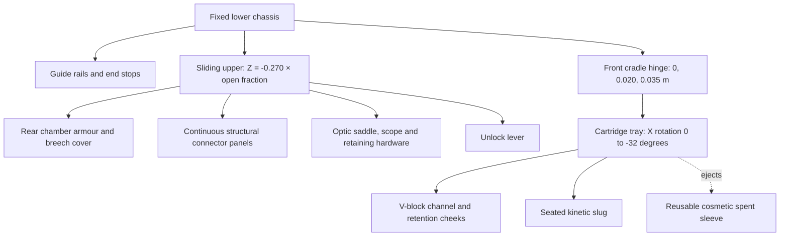

# W02 Railgun: forward upper receiver and hinged loading cradle

The upper receiver and optic now travel together **toward the muzzle (-Z)** to expose the rear loading well. A fixed front hinge raises the cartridge tray, the spent sleeve pops clear, a fresh slug is seated into that same tray, the loaded tray lowers, and the same upper returns toward the stock (+Z) and locks. Baseline reload remains **2.80 seconds**. This supersedes the original fixed-optic/rearward-opening design in the earlier PR commit.

## Mechanical ownership

The fixed keel, stock, grip, accelerator rails and capacitors stay on the chassis. The optic retains its exact transform relative to the upper. The moving structure has overlapping panels at the optic feet and rear shroud, instead of an unsupported bridge. Fixed guides extend across the entire 270 mm travel. The front trunnion stays anchored; the positive-Z end of the tray rises under negative X rotation. The closed shroud clears the seated slug; the open shroud ends forward of the hinge.

Opening: `(x,y,z) = (0,0,-0.270 × cover)` metres. Closing returns that displacement from `-0.270` to `0`. There is no independent cover rise. Cradle pivot is `(0,0.020,0.035)` m, with a 32° upward presentation. A seated slug is a child of the cradle at `(0,0.019,0.097)` m relative to its hinge.

## One gameplay clock

| Action | Seconds |
|---|---:|
| Compact presentation | 0.00–0.22 |
| Unlock | 0.22–0.40 |
| Upper and scope slide forward | 0.40–0.75 |
| Cradle rises; spent sleeve ejects at **1.006** | 0.75–1.07 |
| Retrieve fresh slug | 1.07–1.41 |
| Align and press slug into tray; ammo transfers at **1.91** | 1.41–1.91 |
| Lower loaded cradle | 1.91–2.14 |
| Pull upper rearward and close | 2.14–2.48 |
| Final lock | 2.48–2.66 |
| Return to ready | 2.66–2.80 |

Ejection begins at 80% of the raise phase (89.6% of full hinge angle). The sleeve starts at the actual raised tray location; it then follows a free trajectory with local velocity `(-1.25,+1.05,-0.45)` m/s and Y acceleration `-7.6 m/s²`. It tumbles and falls out of view, with a 0.50 s cosmetic lifetime. Geometry is reused. It is separate from the fired damaging projectile.

The first-person presentation is `(-0.10,-0.210,-0.440)` m with rotation `(0.08,0.50,-0.28)` radians. Whole-rifle depth changes only 20 mm from the ready pose. The support wrist wraps the slug from the left/below to keep the forearm out of the loading window. Hand targets use complete part-to-weapon transforms, including the cradle's parent rotation. The right hand remains attached to the firing grip. The existing third-person body-hand pose remains the legacy pose; the weapon mechanism itself shares the authoritative state.

Slide, hinge, latch, carrier and seated-round state survive interruption. After seating, recovery lowers the actual retained tray before closing. Before seating, recovery finishes opening/raising and retrieves a fresh round. Ammo transfers once; pause freezes the clock. Aiming and charge are blocked while open/unlocked or reloading. Class duration modifiers apply once.

Existing 1.2 s charge/early-release behaviour, projectile piercing, zero falloff, recoil, muzzle discharge and charge/fire WAVs are preserved. No reload Foley or W03 work is included. The six silent markers are revised in [audio-cue-contract.json](audio-cue-contract.json).

## Evidence and validation

See [the rebuild evidence](rebuild/) and [verification output](rebuild/verification.txt). The Armory now includes **TEST RELOAD** so the complete production mechanism can be inspected interactively.

The normal-speed MP4 is a continuous offline export of the actual App renderer, production reload state and hand animator at 30 FPS, with 0.2 s ready bookends. It uses actual Area 51 scene lighting and a static world during capture. It demonstrates the 2.8 s simulation sequence; it is **not real-time GPU performance evidence**. The separate unretimed live-input recording reports actual wall-clock timing in its provenance JSON. Native-laptop visual acceptance remains required for weight, finger clearance and rendering performance.

Focused tests cover direction, scope parenting, fixed hinge, ejection/slug continuity, closure order, recovery, ammo conservation, readiness, 30/60/144 FPS, class modifiers, rig contacts, ADS restoration, existing charge/damage and resource disposal. The broader viewmodel suite checks all visible weapon/hand vertices against the near plane. Build and accepted-weapon regression results are recorded with actual commands and outcomes.

Draft PR #24 remains the review point. No merge or production promotion.
