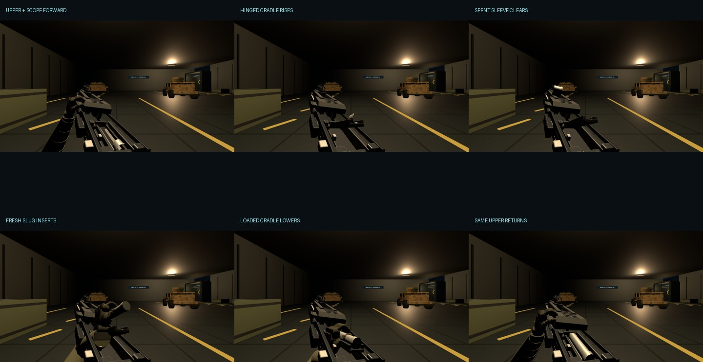

# Rebuild evidence

- [Normal-speed continuous reload, MP4](reload-normal-speed.mp4): 2.8 s animation, 0.2 s ready before and after. Offline export from the real App renderer at 30 FPS; actual scene lighting; static world. [Provenance](video-provenance.json).
- [Armory: closed](armory/model-three-quarter.png), [upper slid forward](armory/model-forward-open.png), [raised cradle](armory/model-cradle-raised.png), [loaded cradle lowering](armory/model-loaded-lowering.png).
- [First-person ready](gameplay/ready.png), [forward open](gameplay/forward-open.png), [cradle rising](gameplay/cradle-raised.png), [carrier clear](gameplay/carrier-eject.png), [fresh slug](gameplay/fresh-slug.png), [insertion](gameplay/inserting.png), [seated](gameplay/seated.png), [lowering](gameplay/lowering.png), [closing](gameplay/closing.png), [lock](gameplay/locking.png), [recovered](gameplay/recovered.png).
- [Actual live-input validation](live/live-validation.json), [timing and six silent cues](live/live-timing.json), [unretimed software-WebGL recording](live/reload-real-time.webm).
- [Checks](verification.txt), [full final typecheck/build/focused output](final-checks.txt), [unchanged charge/fire WAV hashes](preserved-audio.json).

The normal-speed MP4 shows simulation playback, not measured real-time performance. The raw live capture took 27.31 wall-clock seconds for the reload in this software-WebGL environment, with cached background, reduced-resolution rendering and diagnostic lighting. It is included to distinguish actual input execution from offline playback. Native-laptop visual/performance acceptance remains outstanding; the PR stays draft.
