# Screen-left sprint acceptance — PR #15

Base `3778c568db1162d40822676d5d31ffc385b0681a`; runtime correction `99e9beb`.

Camera-local +X projects right. The old default carry translated the breech to +.22 m and yawed the muzzle right by −.85 rad. The new carry translates to −.05 m and yaws the muzzle left by +.72 rad, with −.18 rad controlled downward pitch and −.14 rad roll. Heavy weapons and pistol have shallower class-specific profiles. The existing alternating sway and smooth return/ADS interpolation are unchanged.

TypeScript, production build (existing bundle-size advisory), viewmodel, input and runtime checks passed. All twelve weapons project their actual breech and muzzle screen-left. An exact baseline comparison preserves all twelve FP/actor geometry/materials, hip/ADS/reload poses and hand buffers outside sprint. The actual-input browser run passed forward, strafe, turning, release while moving, immediate ADS, slot switching during sprint, pistol/heavy, wide viewport, pause and lobby. No page errors. Movement physics, speeds, keybindings and the AR/pistol reloads are unchanged.

These are actual gameplay screenshots; the browser uses SwiftShader and does not establish native GPU performance. Turning uses normal embedded LMB drag-look and its commanded AR reports. No forced poses or simulation stepping.

| Case | Before | After |
| --- | --- | --- |
| ready | 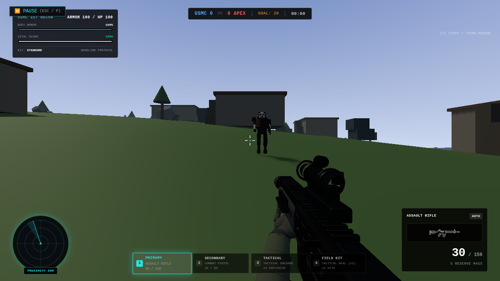 |  |
| straight-sprint | 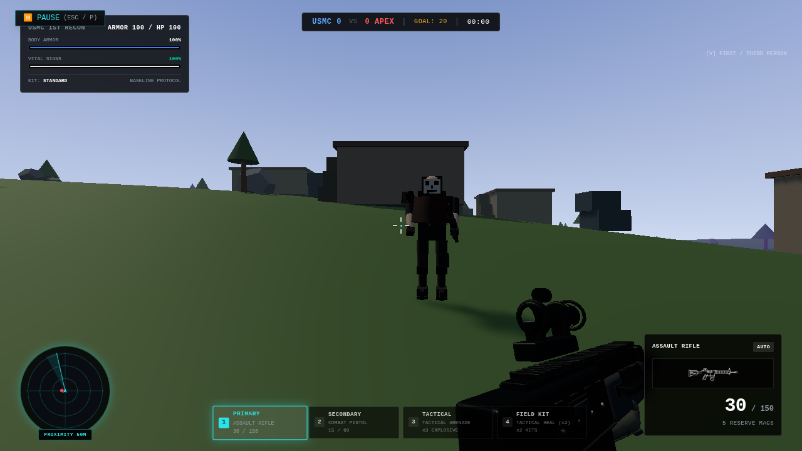 | 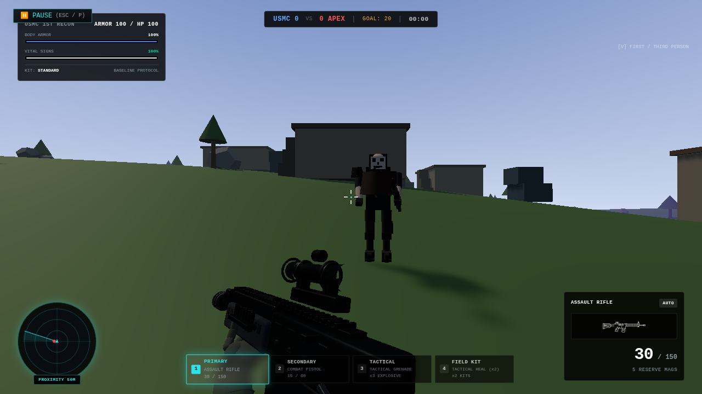 |
| strafe-sprint | 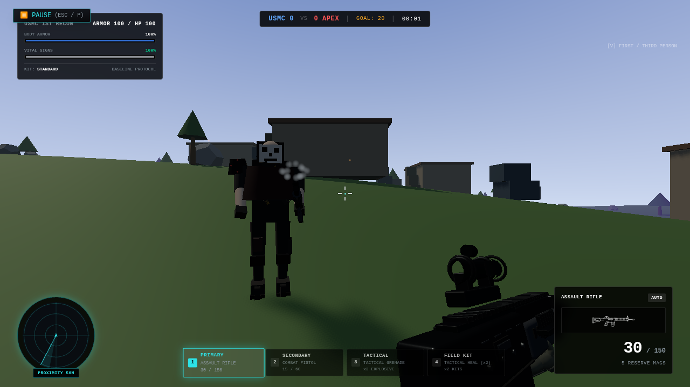 | 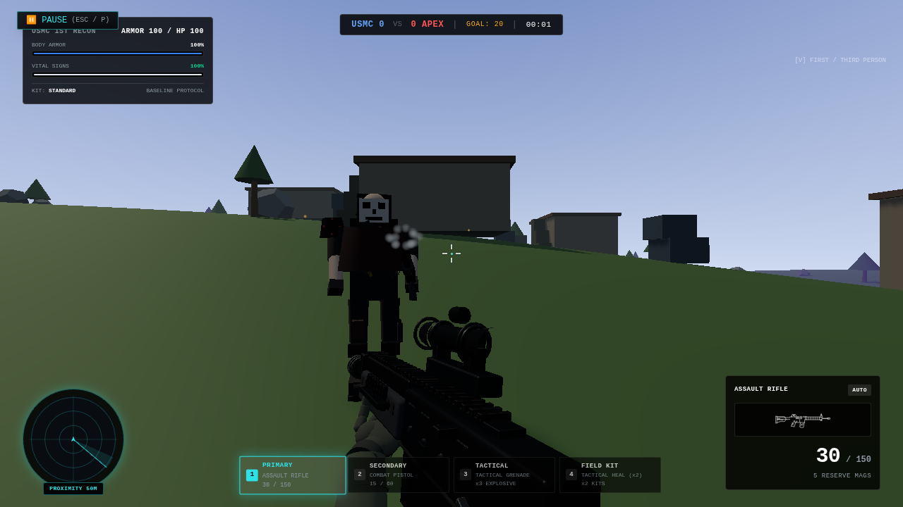 |
| turning-sprint | 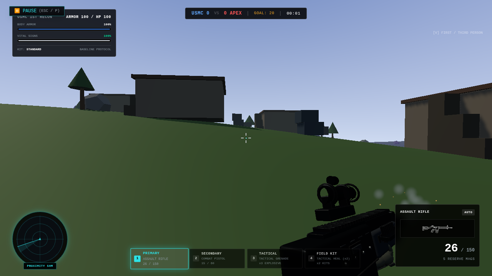 | 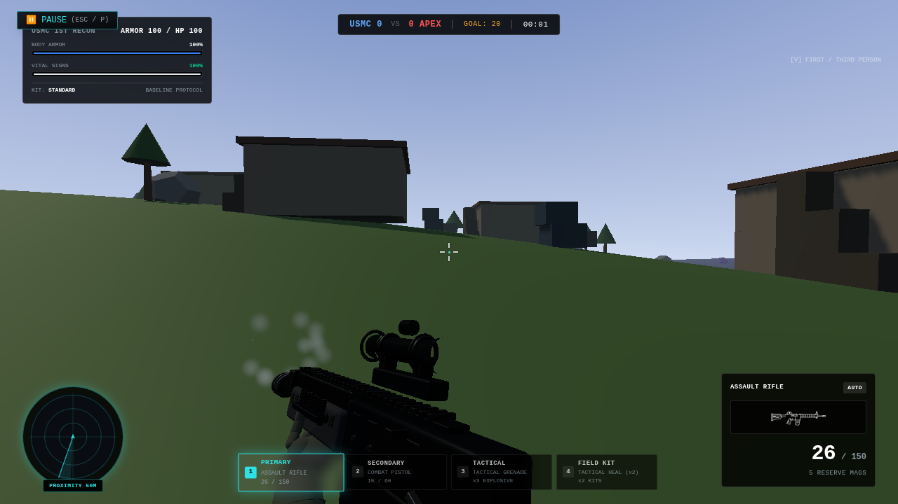 |
| release-sprint-moving | 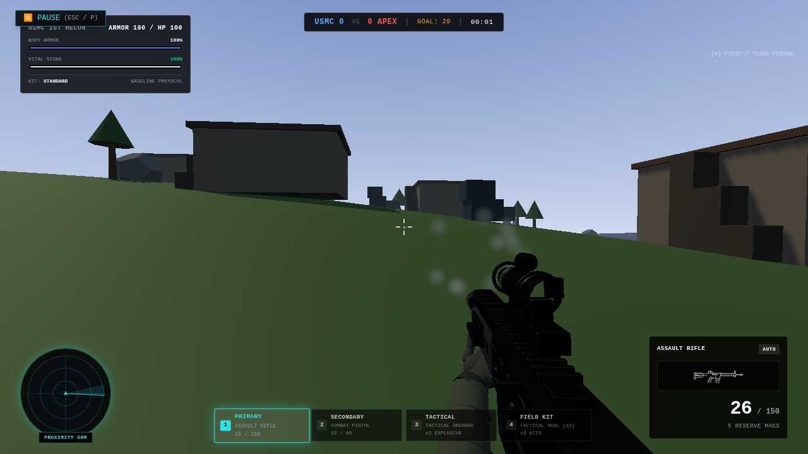 | 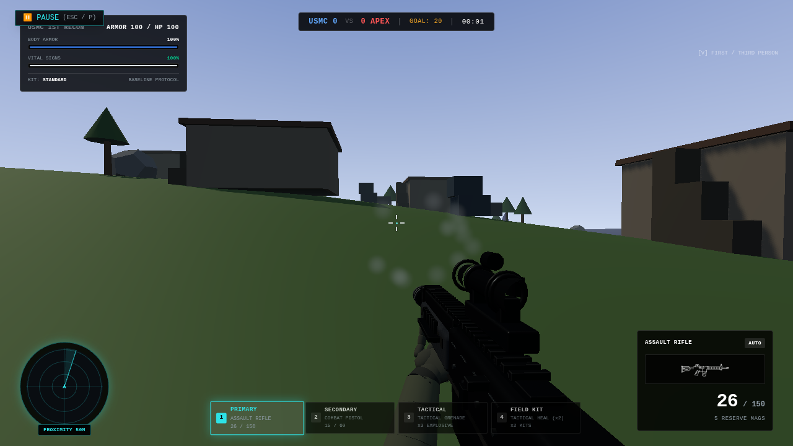 |
| stop-immediate-ads | 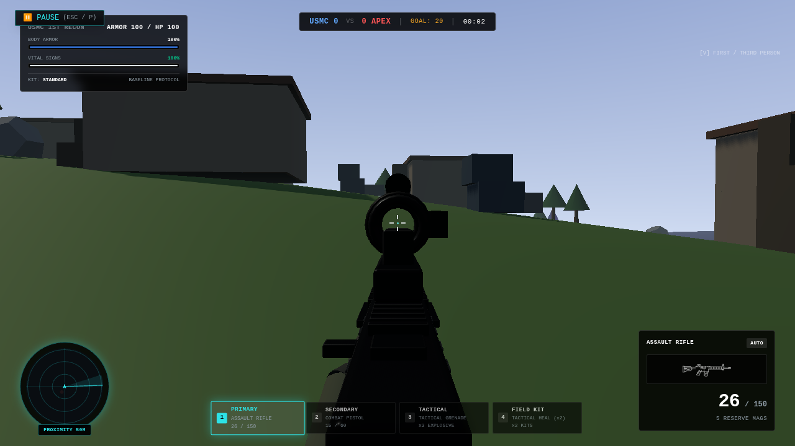 | 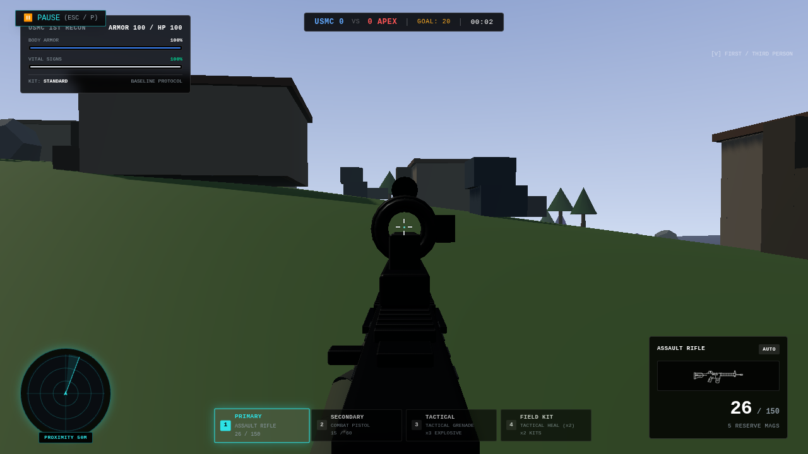 |
| switch-pistol-sprint | 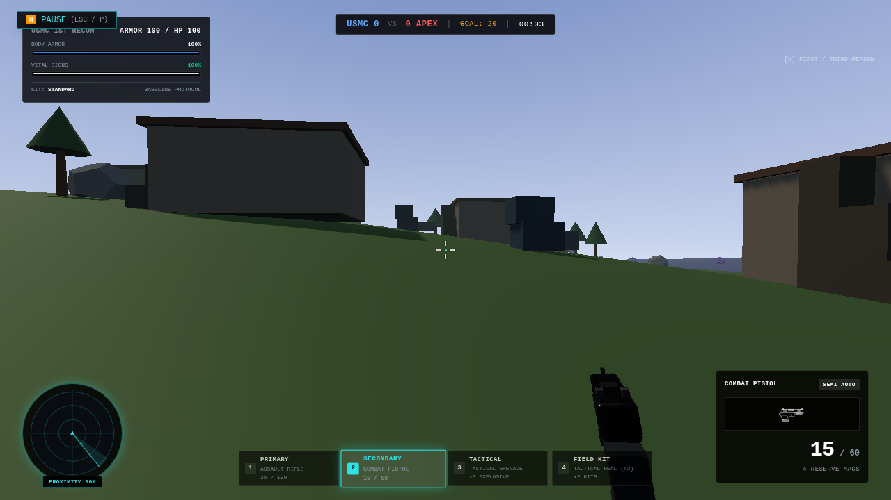 | 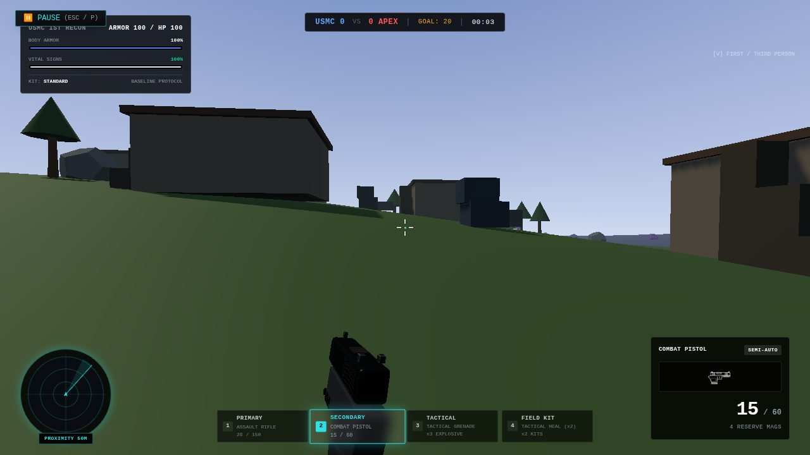 |
| heavy-sprint | 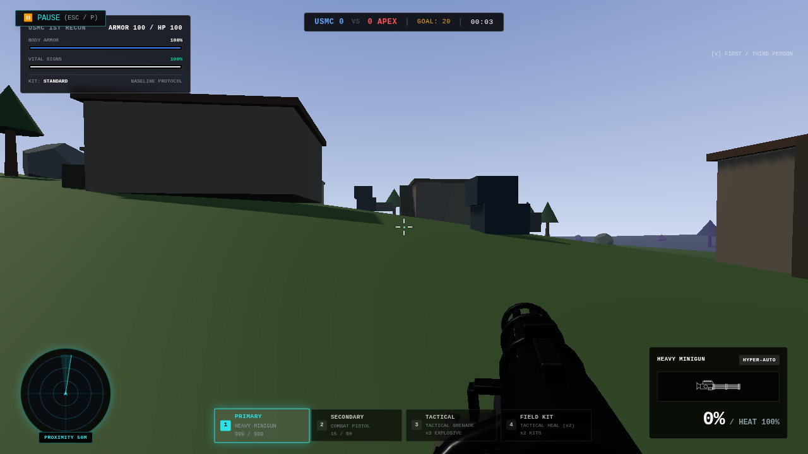 | 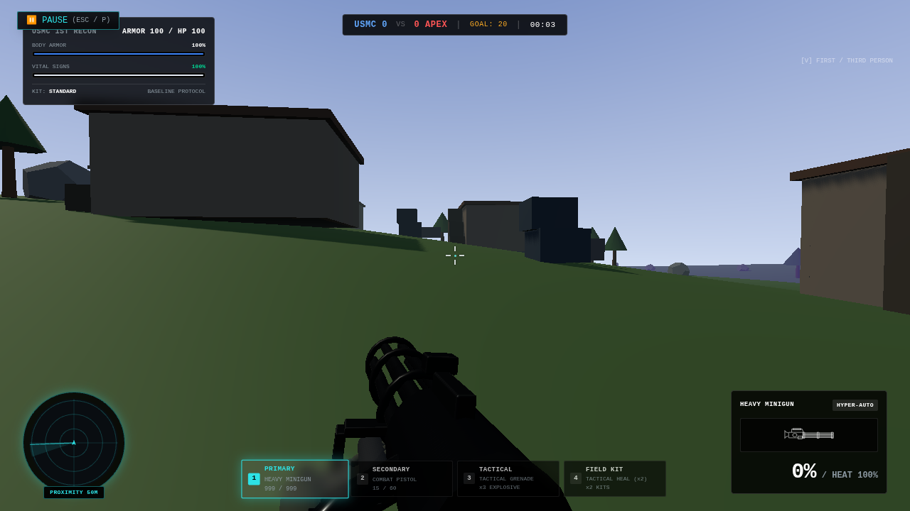 |
| wide-heavy-sprint | 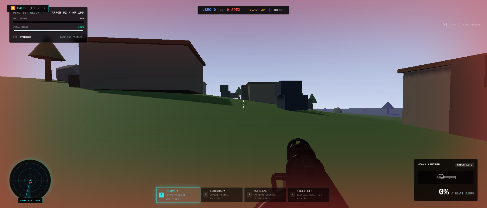 | 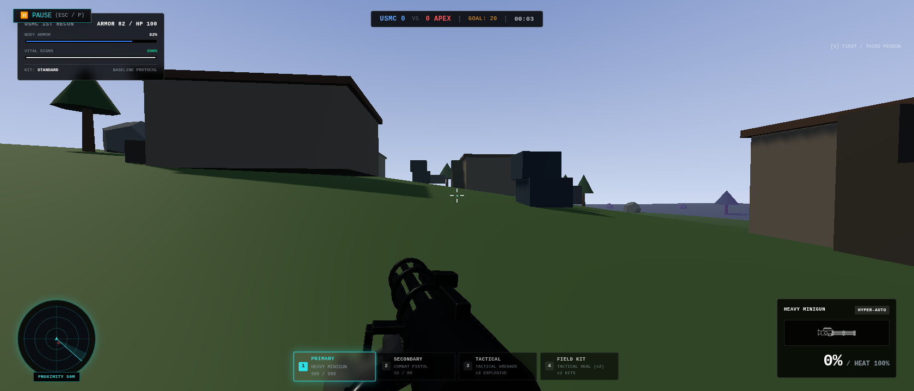 |

[Structured validation and projected screen coordinates](validation.json). Keep PR #15 draft for user visual approval. This change contains no shotgun-specific mechanics.
